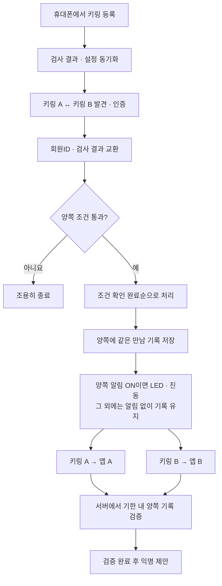

## 최종 1차 통신 명세

작성: 김종무(IOT) / S15P31E106-37 / 2026-10-20

2차 피드백과 추가사항을 정리한 1차 초안이다. 세부 필드와 구현 방법은 실제 테스트와 팀 회의를 통해 보완한다. 위 내용 중 변경된 사항은 아래 정리를 기준으로 한다.

### 전체 흐름

처음 등록·동기화한 뒤에는 휴대폰 없이 키링끼리 매칭하고 기록한다. 앱과 다시 연결되면 각자의 기록을 서버로 전달한다.

---

### 휴대폰 ↔ 키링: 등록·동기화

- 휴대폰에 키링 고유 정보를 등록하고, 키링에는 회원ID를 저장한다. MVP는 회원ID를 사용하고 식별용 참조값으로 변경하는 것은 이후 검토한다.
- 한 계정에 여러 키링을 등록할 수 있지만 활성 키링은 한 개로 한다.
- JSON 형식으로 검사 결과(내 성향, 내가 원하는 성향), 매칭·알림 설정, 거절·차단·채팅 관계 정보를 동기화한다. 프로필 원문과 사진은 키링에 저장하지 않는다.
- 정보 변경 시 즉시 동기화를 시도하고, 수동·재연결·재시작·자정 자동 시도로 보완한다.
- 전원이 꺼져도 설정과 만남 기록은 유지한다. 키링 재시작 후에는 시간·설정 동기화가 끝난 뒤 새 매칭을 시작한다.

### 키링 ↔ 키링: 발견·매칭·알림

- 각 키링이 광고와 스캔을 병행하고 서비스ID로 연결 후보를 찾는다. 기기 인증 후 정보를 교환하며, 공개 광고에는 고정 회원ID를 넣지 않는다.
- 바이너리 형식으로 회원ID와 검사 결과를 교환하고, 알고리즘 판정 대기 큐에서 처리한다.
- 양쪽 조건과 매칭 OFF, 해당 상대와의 채팅·거절·차단 여부를 확인한다. 관계 목록 전체를 보내지 않고 현재 상대와 매칭 가능한지에 필요한 정보만 교환한다.
- 만남 확정은 조건 확인 완료순으로 처리하고, 양쪽 키링에 같은 event_id, 참여 기기, 만남 시각을 저장한다.
- 양쪽 모두 알림 ON일 때만 같은 색 LED와 진동으로 알린다. 한쪽이라도 알림 OFF이면 양쪽 모두 알리지 않고 기록만 저장한다.
- 사용자가 진동이나 LED를 수동으로 끌 수 있어야 한다. 개별 제어 방식과 조합별 동작은 팀 회의에서 정한다.

### 키링 → 앱 → 서버: 만남 기록 전송

- 확정된 만남 기록은 휴대폰 전송 대기 큐에 보관한다. 알고리즘 판정 대기 큐와 구분한다.
- 각 키링의 기록은 각자의 앱이 서버로 전달한다.
- 앱이 기록을 읽었다는 이유로 원본을 지우지 않는다. 서버 저장 완료 확인 후 전송용 원본을 정리하고, 같은 상대의 반복 매칭을 막는 상태는 별도로 유지한다.
- 기한 안에 양쪽의 동일 만남 기록이 서버에서 검증된 뒤 익명 제안을 생성한다.

### 실패·재시도·중복 처리

- 조건 불일치는 조용히 종료한다. 통신 유실·저장 실패는 재시도 대상으로 구분하고, 응답이 없다는 이유만으로 매칭 실패로 확정하지 않는다.
- 기존 기록의 전송 재시도는 허용한다. 같은 이벤트·설정·기록을 다시 받아도 새 이벤트·추가 알림·중복 서버 저장을 만들지 않으며, 세부 처리 방법은 추후 정한다.

### 초기화·분실 관리

- 사용자가 휴대폰에서 본인 키링의 초기화를 요청할 수 있다. 초기화 범위와 미전송 기록 처리 방법은 팀 회의에서 정한다.
- 분실 키링은 고객센터·관리자를 통해 다른 사람이 등록하지 못하도록 처리한다. 구체적인 관리 방법은 팀 회의에서 정한다.

### 테스트·팀 회의에서 보완할 내용

- 검사 결과 필드와 JSON·바이너리의 세부 데이터 형식.
- 활성 키링 변경 방법.
- 저장 한도와 공간 부족 시 처리 방법.

## 키링은 스마트폰이든 키링이든 항상 서로 블루투스 통신을 한다.

---

## 키링 / 휴대폰 통신

1. 키링을 서비스에 등록
   - 키링의 고유 정보를 스마트폰에 등록 or 스마트폰의 고유 정보를 키링에 등록한다. (한 가지 방법 선택)
   - 계정 하나에 여러 키링 등록할 수 있다. (사용자가 키링을 잊어버리거나 다양한 스타일의 키링 혹은 키링 버전 업데이트 되는 상황 가정)
2. 사용자 정보 키링 동기화
   - 사용자 검사 결과 키링에 저장한다.
   - 사용자 프로필 키링에 저장한다.
   - 사용자 프로필 or 검사 결과 업데이트 될 때마다 키링에 정보 동기화 한다.

---

## 키링 / 키링 통신

1. 키링 간 통신
   - 서비스 키링(서비스 고유 정보를 송출)만 서로 통신하며 서로의 검사결과? 성향? 공유한다.
2. 알고리즘 매칭
   - 상대방의 키링에 저장된 성향? 검사결과?를 나의 키링으로 받아 나의 키링의 큐 or 스택에 쌓는다.
   - 스택 or 큐에 저장된 상대방의 성향? 검사결과?를 꺼내어 매칭 알고리즘으의 매개변수로 전달.
   - 매칭 알고리즘을 통해 매칭 여부를 판단한다.
      - 매칭 성공 시
        - 키링이 진동하여 사용자에게 물리적으로 알린다.
        - 상대 키링에 저장된 프로필 정보 or 회원ID를 나의 키링의 큐 or 스택에 쌓는다.
        - 내 키링의 큐 or 스택에 저장된 상대 정보를 내 휴대폰으로 송신한다.
      - 매칭 실패 시
        - 뭐 있나?

---

## 피드백 결과

1. 키링 서비스 등록시 키링 고유 정보를 휴대전화에 등록 키링에는 회원ID 등록
2. 한 계정에는 여러 키링 등록 가능
3. 키링 꺼질시(배터리 고갈) 키링 안에 저장된 모든 정보 삭제
4. 키링에 회원정보(회원ID, 검사 결과)를 주기적으로 동기화
5. 키랑 간 통신은 바이너리통신으로 상대 키링과 정보를 주고받는다.
6. 키링 간 통신을 할 때 회원ID와 검자결과 둘 다 받는다.
7. 매칭 알고리즘으로 가기 전 대기하는 큐와 알고리즘 매칭 성공시 휴대전화로 정보 전송 대기하는 큐 이렇게 두 개 사용함.
8. 휴대전화 키링간 통신으로 데이터 주고 받을 때는 JSON형식으로 주고받는다.

---

## 2차 피드백 with AI

1. 휴대폰에 키링 정보, 키링에 회원ID 등록 : 일단은 회원ID를 MVP로 하고 서버가 해석할 수 있는 불투명한 값으로 변경하는 것을 이후로 한다.
2. 계정 하나에 여러 키링 등록 : 여러개 등록 가능 단 활성 키링 한 개로 변경
3. ~~전원이 꺼지면 모든 정보 삭제 : 폐기~~
4. 회원정보 주기적 동기화 : 프로필 정보는 넣지 않는다. 매칭⋅알림 설정, 거절⋅차단⋅채팅 관계 변경도 반영한다. 변경 즉시 시도하고 수동⋅재연결⋅재시작⋅자정 자동 시도로 보완한다.
5. 키링끼리 바이너리 통신 : 이건 어떻게 구현해야 할 지 아직 잘 모르곘음 안해봐서.
6. 회원ID와 검사 결과 교환 : 회원ID와 검사결과(내 성향, 내가 원하는 성향 검사 결과로 구성됨)를 일단 MVP로 구현한다. (이 내용은 후순위 식별용 참조값과 매칭에 필요한 최소 구조화 데이터를 교환하세요. 공개 광고에는 고정 회원ID를 넣지 않고, 필요한 데이터는 인증된 연결에서 교환해야 합니다.)
7. 판정 대기 큐와 후대폰 전송 대기 큐 : 조건 확인 완료순, 반복 매칭 막는 상태는 별도로 유지한다.
8. 휴대폰/키링은 JSON : 나중에 검사결과 필드가 정의되면 진행
9. 양방향 판단 : 매칭 OFF ⋅ 이미 매칭되어 채팅중인 상대인지 ⋅ 거절 ⋅ 차단 정보도 키링에 동기화 하여 저장되고 이 정보도 다른 키링과 통신할 때 보낸다.
10. 양쪽의 동일만남 기록 : event_id, 참여기기, 만남 시각을 기록한다.
11. 알림 조건 확인 : 양쪽 알림 ON일 때만 LED, 진동(LED, 진동은 옵션) 한 쪽이라도 LED, 진동 모두 OFF면 양쪽 모두 OFF
12. 앱을 통한 독립 업로드 : 각 키링의 기록을 각 앱이 서버로 전달한다. 앱이 키링 원본 기록을 읽은 후 지우지 않는다.
13. 서버 검증 후 익명 제안 : 기한 내 양쪽 기록이 검증돼야 제안을 생성
14. 실패 구분 : 조건 불일치는 조용히 종료하되, 통신 유실·저장 실패는 재시도 대상으로 구분한다. 응답이 없다는 사실만으로 ‘매칭 실패’로 확정하지 않습니다.
15. 중복 처리 : 같은 이벤트 · 설정 · 기록을 받아도 새 이벤트 · 추가 진동 · 중복 서버 제출을 만들지 않는 규칙 필요 이건 추후 생각한다.
16. 저장한도: 이것도 실제로 해보면서 고민해봐야 할 듯
17. BLE 연결 역할 : 각 키링이 광고 · 스캔 병행해야 함. 키링 등록시 휴대폰에 동기화된 서비스ID로 각 키링이 해당 서비스 키링인지 판별한다.

### 추가 사항

- 사용자가 휴대전화로 키링 초기화 요청하면 키링에 들어있는 정보들 초기화.
- 분실시 고객센터 문의 관리자가 가짜 회원 데이터에 키링 연결해서 다른 사람이 등록못하게 한다.
- 진동이나 LED를 수동으로 끌 수 있어야 한다.

---
