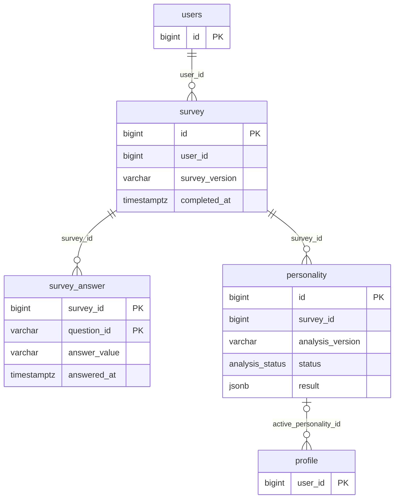
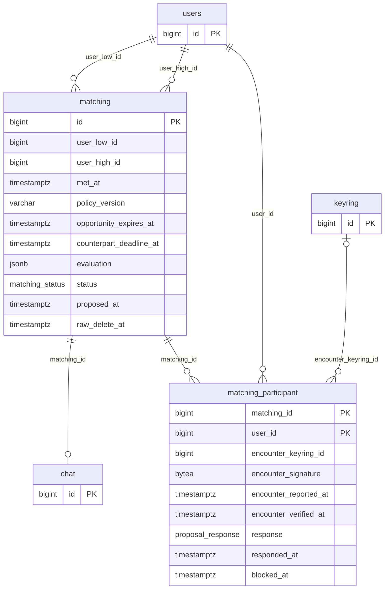
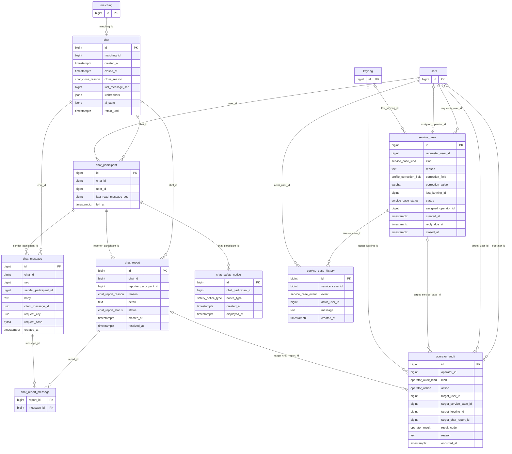

# Tingle(팅글) ERD·테이블 정의

## 2026-10-27 21개 테이블 설명 보완과 미해결 계약

담당 김영빈(BE), 관련 S15P31E106-91·92, 영향 FE·BE·AI·IoT. 기준 develop `3c26bbb8f82a78e442d56e57373ad21a25988989`. 사용자 제공 2026-10-27 DBML과 후속 SQL을 대조한 설명 보완이다. 첨부 원본과 실제 DB는 보존한다. 로컬 설계 artifact는 아래 최신 21개 정의로 갱신한다. 아래 로컬 SQL·metadata·관계도는 21개 테이블 설계로 정합화했다. 서버·JPA·공용 DB 적용은 별도이며 완료하지 않았다. 기획·기능 명세·정책·UX 원문은 수정하지 않는다.

DBML 상단의 단계별 변경 이력보다 실제 Table·컬럼 정의를 기준으로 읽는다. 후속 SQL에는 `user_setting.settings_version`의 같은 트랜잭션 증가와 `keyring.synced_settings_version`의 ACK 검증·늦은 ACK 무시·재등록 시 NULL 설명이 추가됐다. 이는 다른 담당과의 연동 근거로 보존하며 해당 정의를 직접 고치지 않는다. 후속 내보내기는 MySQL식 백틱/COMMENT와 PostgreSQL식 bytea·jsonb·timestamptz/명명 enum을 함께 포함하므로 실행 가능한 PostgreSQL DDL로 간주하지 않는다. SQL을 실행하지 않는다.

### 명확히 보완할 컬럼 의미

| 테이블·컬럼 | 설명 및 서버 계약 |
| --- | --- |
| `survey.id`, `survey.user_id` | 첨부의 sessionId는 survey.id bigint다. 인증된 회원 소유 회차만 읽고 변경한다. 기존 공개 UUID 계약과의 변환은 아래 이관 항목으로 별도 검토한다. |
| `survey.survey_version`, `completed_at` | 시작 때 설문 버전을 고정하고 완료 답변은 불변으로 취급한다. 제출 완료와 분석 성공은 별개다. |
| `survey_answer.(survey_id, question_id)`, `answer_value`, `answered_at` | 회차의 고정 버전으로 문항·보기 값을 검증하고 완료 전의 해당 문항만 갱신한다. 시각만으로 동시 수정 충돌을 해결했다고 보지 않는다. 첨부에는 기존 revision 대응이 없다. |
| `personality.survey_id`, `analysis_version`, `status`, `result` | 완료 회차·분석 버전별 결과와 실행 상태를 구분한다. PENDING/FAILED/INSUFFICIENT 결과가 기존 유효 분석을 덮어쓰지 않는다. |
| `profile.active_personality_id` 연동 | 재검사 대기·실패·응답 부족 중 기존 유효 결과 유지. 새 결과가 SUCCEEDED이고 동일 회원·요청 대상·버전의 유효한 최신 실행임을 확인한 후 결과 저장과 적용 포인터 전환을 원자 처리한다. 늦은 이전 분석이 최신 결과를 되돌리지 않아야 한다. 프로필 담당과의 연동 요구이며 이 컬럼을 직접 수정한 것은 아니다. |
| `matching.id` | 첨부는 한 쌍의 행이 제안도 나타내며 API proposalId와 대응한다. WAITING/NOT_MATCHED의 내부 행을 제안으로 공개하지 않는다. PENDING 이후 재사용 금지와 제품의 재매칭 정책 충돌은 아래에서 구분한다. |
| `matching.proposed_at` | **양쪽 기록 검증 후 서버가 제안 생성을 확정한 최초 시각**이다. 푸시 발송·수신·첫 조회 시각이 아니다. 응답 마감은 이 시각+24시간이며 재전송·재시작·알림 실패로 연장하지 않는다. API Proposal.createdAt 및 expiresAt이 각각 이 기산점과 마감을 표현해야 한다. |
| `matching_participant.response`, `responded_at` | 본인 응답과 최초 서버 확정 시각이다. 앱이 누른 단말 시각을 신뢰하지 않는다. 상대 응답값·시각·내부 ONE_ACCEPTED를 미응답자에게 그대로 공개하지 않는다. |
| `chat.matching_id`, `created_at` | 상호 수락 확정과 방·두 참여자 생성은 같은 원자 처리 단위다. 중복 수락은 같은 방·최초 생성시각을 반환한다. 한쪽 수락·거절·만료는 방을 만들지 않는다. |
| `chat.closed_at`, `close_reason` | 최초 실제 종료 효력 시각을 고정한다. 정상 만료는 created_at+168시간이며 배치 실행 시각이 아니다. 구체 종료 사유는 상대에게 노출하지 않는다. |
| `chat_message.seq`, `sender_participant_id`, `client_message_id`, `request_key`, `request_hash` | 순번·발신자·재전송 식별자·본문 충돌 판정의 역할을 유지한다. 동일 재전송은 최초 메시지 ID·seq·created_at을 반환한다. 참여자 ID는 내부 식별자이며 공개 sender는 ME/PARTNER로 투영한다. |
| `chat_participant.last_read_message_seq` | 본인에게 새로 표시할 **수신 메시지**는 seq가 본인 확인 순번보다 크고 발신 참여자가 본인이 아닌 메시지다. 본인이 보낸 메시지를 새 수신 메시지로 세지 않는다. 상대에게 본인 확인 순번을 공개하지 않는다. |
| `chat.icebreakers`, `ai_state` | 생성 상태·결과와 최소 실행 메타데이터를 기존 JSON에 둘 수 있다. 질문 실패 시 기본 질문 대체, 질문 없이도 채팅 가능. 위험 분석 미실행·실패를 안전으로 표시하지 않는다. 종료·철회 후 외부 전송·계속 분석·늦은 결과 반영을 차단한다. |
| `chat_safety_notice` | 같은 방 참여자·유형별 생성 중복을 막고 displayed_at은 실제 표시 ACK의 최초 시각으로 유지한다. 해당 수신자만 조회·ACK 가능하며 안내만으로 자동 제재·신고·차단하지 않는다. |

### WAITING/NOT_MATCHED 행 재사용의 필요 조건

옛 기록 재전송은 원래 접수 결과를 재사용하고 기한·검증·분석을 새 만남으로 초기화하지 않는다. 새 만남은 실제 이탈·재접근을 증명하는 새 이벤트와 당시 소유·설정 문맥이 검증돼야 한다. 쌍과 접수 처리의 동시성을 직렬화하고 재사용 직전 상태·제안 생성 여부·차단을 다시 검사한다. 상대 기록 대기 중 다른 이벤트를 덮어써 한 만남의 두 증명을 섞어서는 안 된다. 새 만남으로 대체할 수 있는 WAITING의 정확한 종료/우선순위 규칙은 IoT·제품 합의가 필요하다.

재사용을 승인한 경우의 초기화 대상은 `met_at`, `policy_version`, 두 마감시각, `evaluation`, `proposed_at`, `raw_delete_at` 및 두 참여자의 `encounter_*`, `response`, `responded_at`이다. 과거 값을 새 실행에 이어 쓰지 않고 새 검증값/NULL로 원자 교체한 뒤 새 유효 제출을 기록한다. `blocked_at`은 지우지 않으며 차단된 관계를 재사용하지 않는다. 정책 버전·새 마감값은 검증된 새 이벤트 기준으로 고정한다.

이전 원본 삭제 작업은 matching.id만으로 새 행의 encounter_*를 지우면 안 된다. 선점 당시의 **만남 세대/이벤트 식별자와 삭제 기한**이 여전히 같고 현재 기한이 지났을 때만 조건부 삭제해야 한다. 같은 행을 재사용하면 이전 삭제 예약·늦은 검증/AI 응답도 새 세대에 적용되지 않아야 한다. 마감시각 하나만의 일치로 세대 식별을 대신하지 않는다.

**정보 부족:** 첨부에는 영속 eventId/submissionId·재사용 세대와 원본 삭제 후 재전송 판별용 최소 식별정보가 명시돼 있지 않다. 기기 서명의 입력·동일 이벤트 판별 기준도 없다. 기존 evaluation JSON에 세대/최소 해시를 둘지, 다른 저장 위치·보존기간을 사용할지 합의해야 한다. 컬럼 추가를 무조건 요구하는 것은 아니지만 현재 설명만으로 안전한 재사용·삭제가 해결됐다고 볼 수 없다.

### AI 재시도 JSON 보완안 — 실행 계약 합의 필요

적용 위치는 `personality.result`, `matching.evaluation`, `chat.icebreakers`, `chat.ai_state`다. background_job 제거를 근거로 진행·복구에 필요한 정보를 생략하지 않는다. 다음은 설명을 구체화한 서버 연동 제안이며 AI 계산·모델 정책 확정이 아니다.

- `attempts`는 실제 실행을 원자 선점할 때 증가하며 최초 실행을 1로 세는 안이다. 최대 3회는 최초 1회+재시도 2회다. 원문 attempts<3의 최초 실행 포함 여부가 불명확하므로 AI 담당 확인 전 합의 완료로 표시하지 않는다.
- 5분은 현재 실행을 선점하고 PENDING을 저장한 서버 시각 `attemptStartedAt`부터 계산하는 안이다. 사용자의 최초 요청 시각·다음 재시도 예정시각·결과 생성시각으로 대신하지 않는다. 아직 선점하지 않은 대기 상태도 복구하려면 `queuedAt` 또는 구분된 실행 단계가 필요하다.
- 기존 JSON 안에 `attemptStartedAt`, `attemptId`(또는 증가하는 실행 세대), 대상/입력 버전 식별값을 정의하고 상태·시각·attempts를 함께 저장하는 안이다. 이는 논리 정보 제안이며 추가 DB 컬럼 확정이 아니다. 작업 정체 복구와 정상적으로 오래 걸리는 실행을 구분할 lease/갱신 규칙도 필요하다.
- 여러 서버가 같은 작업을 조회해도 조건부 갱신/잠금으로 하나만 선점한다. 완료는 자신의 attemptId·대상 세대·현재 상태·권한이 여전히 유효할 때만 반영한다. 이전 시도나 종료된 방의 늦은 응답은 버린다. 위험 분석에는 처리 대상 메시지 구간/마지막 성공 순번을 구분해 누락·역행을 막는다.
- FAILED이고 attempts<3이며 nextRetryAt이 지난 작업, 5분을 넘긴 현재 실행을 DB 상태로 재선점한다. 재시작 뒤 메모리 큐만으로 판단하지 않는다. 최대 횟수에 도달한 정체 실행의 최종 실패·대체 결과 규칙도 정의해야 한다. 외부 호출의 중복 비용은 DB 선점만으로 제거되지 않으므로 공급자 멱등 지원·실행 키를 AI 담당과 확인한다.

**정보 부족:** 현재 명시된 attempts/nextRetryAt/lastErrorCode만으로 PENDING 5분 기산점·늦은 결과 차단·대상 교체·재시작 복구를 검증할 수 없다. 재시도 간격, 타임아웃/lease, 결과 입력 식별자, 최대 횟수의 의미를 확정해야 한다. AI 모델·추론 기준은 변경하지 않는다.

### 가을·IoT 소유자 변경 연동

접수 시 현재 소유자 확인 외에 **기록 생성 당시 소유 구간**을 검증해야 한다. 미등록 중 생성한 기록·이전 소유자의 지연 업로드는 새 소유자의 정상 만남과 구분해야 한다. 등록 후 새 소유 구간에서 생성·서명 검증된 정상 기록까지 “이후 그 기기 기록 무시”로 영구 차단하면 안 된다.

기기 고유 서명이 소유자 변경 전후 동일 키를 사용하면 서명과 현재 owner_user_id만으로 옛 기록을 걸러낼 수 없다. 소유 세대/등록 구간, 증명에 포함되는 주체·이벤트·시각, 새 등록의 이전 기록 제거 또는 거부 기준을 가을·IoT가 제공해야 한다. 영빈 접수 API는 그 증명을 검증하고 미확인/이전 세대 기록을 새 제안 생성에 쓰지 않는 연동 요구만 정리한다. 키링 상태·통신·소유 정의는 직접 변경하지 않는다.

### 정책 충돌과 API 이관 영향

| 항목 | 최신 첨부/기존 API의 차이 | 처리·합의 필요 |
| --- | --- | --- |
| 재매칭 | 첨부는 PENDING 이후 영구 금지. MVP는 거절 30일·무응답 만료 후 실제 새 만남 허용 | 정책 원문 유지. 한 쌍 한 행/제안 ID 재사용·멱등 키·재매칭 최소 기록을 함께 합의해야 한다. |
| 키링 | 첨부는 다중 등록·UNBOUND/REGISTERED, 초기화/분실 차단 제외. MVP는 최대 1개·초기화·영구 사용 불가 유지 | 가을·IoT 인계. 접수 API가 제품 필수 기능을 조용히 삭제하지 않는다. |
| 신고 | 첨부는 신고 표/retain_until 90일. MVP는 신고 후속·신고 전용 보관 없음 | 표 존재로 신고 API를 현재 MVP로 활성화하지 않는다. 기존 OpenAPI createReport와 신고 보관 설명도 정리 대상이다. |
| 탈퇴·보관 | 첨부는 matching/채팅 즉시 삭제 및 신고 예외. MVP는 실제 종료+30일, 재매칭 제한 최소 기록은 탈퇴 완료+1년 | 가을 사건 연동과 관계 유지/익명화·삭제 순서 합의 필요. 최소 관계 기록을 채팅 원문과 함께 삭제하지 않는다. |
| 수락 취소 | 기존 API에 cancel 존재, 현재 MVP는 수락 후 취소 없음 | 활성 endpoint 제거와 참조/화면/구현 영향을 별도 대조해야 한다. 이번 경로 정리는 해당 기능 승인이나 삭제 완료가 아니다. |
| 공개 ID | sessionId/resultId/chatRoomId/messageId는 기존 UUID, 첨부는 bigint. proposalId는 양수 int64지만 대상이 match_proposals→matching으로 변경 | 경로 파라미터·DTO·중첩 예시·커서·연결 필드·기존 발급 ID의 이관/구버전 처리를 함께 결정한다. 공용 deviceId/userId는 담당 인계. UUID인 clientMessageId/request_key/family_id는 유지한다. |
| 정밀도 | bigint 공개 응답은 JavaScript 안전 정수 범위를 넘을 수 있음 | number(int64) 또는 십진 문자열의 FE 전송 합의 필요. DB bigint만으로 타입·예시를 일괄 치환하지 않는다. |
| 작업 상태 | 첨부 background_job 제거, 기존 요청 응답은 Job/jobId·GET jobs | 각 도메인 상태 조회/202 응답·Location·오류·실행 키 대응을 합의한다. 작업 조회를 참조만 남긴 채 삭제하지 않는다. |
| 설문 동시성 | 첨부 revision 없음, 기존 ETag/revision 조건부 저장 | 동시 저장·완료와 재검사 순서의 조건부 갱신 수단이 필요하다. 의미 없는 revision을 꾸며 내지 않는다. |
| 읽음 | 첨부는 본인 마지막 순번·상대 비공개, 기존 API는 readByPartner와 개별 메시지 ACK | 단순 seq 최대값은 화면에서 건너뛴 메시지를 읽음 처리할 수 있다. 연속 확인 범위와 새 메시지 표시, 상대 readByPartner 제거 및 FE 적용을 함께 정해야 한다. |
| 메시지 멱등 | 첨부 유일키는 sender_participant_id 범위, 기존 request_key는 회원 발신자 범위 | 같은 회원이 다른 방에서 키를 재사용할 때의 충돌을 기존 제약만으로 막을 수 있는지 확인해야 한다. |
| 삭제 관계 | 첨부 matching 삭제와 신고 채팅 보존·chat.matching_id NOT NULL이 충돌 가능 | FK/논리 관계·삭제 순서·잔존 참조를 가을과 확인한다. DBML Ref가 실제 운영 FK로 적용됐다고 가정하지 않는다. |

수명은 별개다. 만남 원본은 첨부 raw_delete_at(기준 사건+14일)에 encounter_*를 정리한다. 제안 접근 종료는 본인 결정·기한·권한으로 판정한다. 채팅 이용 종료는 실제 closed_at에 적용하고 원문 보관은 MVP의 closed_at+720시간이다. 최소 관계 기록은 재매칭 제한의 별도 목적·기한을 따른다. 재시도나 회원 탈퇴로 이미 정해진 종료시각을 다시 시작하지 않는다. 원본 삭제 후 최소 식별정보 보존 범위도 별도 합의한다.

위 설명은 설계 대조다. 아래 2026-10-22 통합 자료의 테이블 수·DDL·구현 상태를 21개 테이블 적용 근거로 사용하지 않는다. 저장소의 과거 25/185·28/204 표기도 서로 다른 시점의 자료이며 첨부의 검증 수치로 대체하지 않는다.

## 현재 설계 정의 — 2026-10-28 / 21개 테이블·151개 컬럼

사용자 제공 2026-10-27 DBML의 실제 Table·컬럼·enum·인덱스·Ref를 기준으로 작성했다. 과거 25/185·28/204 자료는 변경 이력의 당시 상태이며 현재 정의가 아니다. 원본 첨부는 보존했다.

[기계 판독 정의](tables.json) · [PostgreSQL 설계 DDL](schema.sql) · [ERDCloud 도식 가져오기](erdcloud-import.sql) · [검증](../verification/erd21-alignment-20261028.md)

관계는 35개의 논리 참조다. 기존 프로젝트의 물리 FK 미사용 원칙을 유지한다. 특히 회원·matching 삭제와 신고 채팅 보관의 참조 잔존은 합의가 필요하다. SQL은 새 빈 DB용 검토 설계일 뿐 마이그레이션·실행·배포 증거가 아니다.

| 표 | 컬럼 수 | 역할 |
| --- | ---: | --- |
| `personality` | 5 | 성향 분석 결과 — 설문 한 번 분석 = 한 줄. 분석 결과만 담고, 매칭 조건은 matching_preference에 |
| `users` | 7 | 회원·인증·동의 |
| `refresh_token` | 9 | 로그인 토큰(기기별) |
| `push_installation` | 7 | 푸시 알림 기기 |
| `operator_audit` | 11 | 운영자 활동 기록 — 운영자가 회원 정보를 보거나 고치거나 권한을 바꾼 일을 남기는 기록 |
| `matching` | 11 | 만남·제안·차단 관계 — 두 사람당 한 줄. 사람별 기록(만남 기록·수락/거절·차단)은 matching_participant에 |
| `keyring` | 7 | 실물 키링 |
| `chat_message` | 9 | 채팅 메시지 |
| `survey` | 4 | 설문 회차 — 설문 한 번 = 한 줄. 문항별 답은 survey_answer에 |
| `chat` | 9 | 채팅방 — 매칭 한 건당 방 하나. 사람별 상태는 chat_participant에. 참여자 한 명이 탈퇴하면 방과 딸린 표 모두 삭제. 단 신고된 방은 retain_until까지 보관 |
| `profile` | 11 | 프로필 |
| `matching_preference` | 6 | 매칭 조건 — 회원당 한 줄. 어떤 상대를 매칭할지 회원이 정한 조건. 바꾸면 user_setting.settings_version이 1 올라 키링에 다시 보냄 |
| `user_setting` | 4 | 회원 설정 — 회원당 한 줄. 키링 진동·LED와 키링에 보낼 설정 버전 |
| `matching_participant` | 9 | 매칭 참여자별 기록 — 매칭 한 건에 두 사람이니 두 줄. 각자 보낸 만남 기록, 수락/거절, 차단을 사람별로 저장 |
| `chat_participant` | 5 | 채팅방 참여자 — 채팅방 하나에 두 사람이니 두 줄. 각자 어디까지 읽었는지, 나갔는지 저장 |
| `chat_report` | 8 | 채팅 신고 — 신고 한 건당 한 줄. 첫 신고가 들어오면 chat.retain_until(+90일)이 정해짐 |
| `chat_report_message` | 2 | 신고에 첨부한 메시지 — 신고 한 건에 메시지 여러 개를 고를 수 있어 따로 둠. 신고 하나 × 메시지 하나 = 한 줄 |
| `chat_safety_notice` | 5 | AI 위험 안내 — AI가 위험한 대화를 감지했을 때 한 사람에게 보여 준 안내. 같은 사람·같은 유형은 방마다 한 번만 |
| `survey_answer` | 4 | 설문 문항별 답 — 설문 한 번에 문항 수만큼 줄. 문항·보기 내용은 설문 파일(survey/{버전}.json)에 있고 여기엔 고른 값만 |
| `service_case_history` | 6 | 지원 요청 처리 기록 — 추가 확인 요청·회원 답변·운영 작업 결과를 일어난 순서대로 한 줄씩 |
| `service_case` | 12 | 정정·분실 지원 요청 — 요청 한 건 = 한 줄. 처리하며 주고받은 기록은 service_case_history에 |

### personality

성향 분석 결과 — 설문 한 번 분석 = 한 줄. 분석 결과만 담고, 매칭 조건은 matching_preference에

| 컬럼 | 타입 | NULL | 키·참조 | 설명 |
| --- | --- | --- | --- | --- |
| `id` | `bigint` | 불가 | PK, 자동 증가 | 분석 결과 ID — 공개 분석 결과 ID. API resultId |
| `survey_id` | `bigint` | 불가 | survey.id | 설문 회차 ID — 분석한 완료 설문 회차 ID. 회원은 survey에서 확인 |
| `analysis_version` | `varchar(30)` | 불가 |  | 분석 규칙 버전 — 채점·유형 계산 규칙의 버전 이름. 규칙 내용은 DB가 아니라 서버 설정 파일(analysis/{버전}.json)에 있음 |
| `status` | `analysis_status` | 불가 |  | 분석 상태 — PENDING / SUCCEEDED / INSUFFICIENT / FAILED. PENDING으로 5분 넘게 멈췄거나 FAILED이고 재시도 횟수가 남았으면 주기 작업이 다시 분석 |
| `result` | `jsonb` | 가능 |  | 분석 결과 — 내부 점수·성향 데이터·사용 버전 또는 재확인/실패의 최소 정보. 재시도 정보 {attempts, nextRetryAt, lastErrorCode} 포함 |

인덱스: UNIQUE survey_id, analysis_version (`uq_personality_survey_version`).

### users

회원·인증·동의

| 컬럼 | 타입 | NULL | 키·참조 | 설명 |
| --- | --- | --- | --- | --- |
| `id` | `bigint` | 불가 | PK, 자동 증가 | 회원 ID — 서비스 회원 번호. DB가 1씩 올려 발급(재사용 안 함). 탈퇴 후 재가입하면 새 번호 |
| `provider` | `auth_provider` | 불가 |  | 소셜 로그인 종류 — 소셜 제공자 코드: GOOGLE / KAKAO / NAVER |
| `provider_user_id` | `varchar(255)` | 불가 |  | 소셜 계정 고유값 — 서버가 제공자 인증으로 확인한 소셜 계정 고유값 |
| `email` | `varchar(320)` | 가능 |  | 연락용 이메일 — 동의 조건을 충족한 연락용 이메일. 미제공·철회·탈퇴 시 정리하며 계정 식별이나 상대 공개에 사용하지 않음 |
| `signup_completed_at` | `timestamptz` | 가능 |  | 가입 완료 시각 — 최초 가입을 모두 완료한 시각 |
| `agreed_at` | `timestamptz` | 가능 |  | 일괄 동의 시각 — 첫 화면에서 약관·개인정보·AI 분석 등에 한 번에 동의한 시각. 비어 있거나 새 약관 시행일보다 이르면 재동의 받음 |
| `is_operator` | `boolean` | 불가 |  | 운영자 여부 — 운영 화면 접근 가능 여부. 일반 회원은 false |

인덱스: UNIQUE provider, provider_user_id (`uq_users_provider_account`).

### refresh_token

로그인 토큰(기기별)

| 컬럼 | 타입 | NULL | 키·참조 | 설명 |
| --- | --- | --- | --- | --- |
| `id` | `bigint` | 불가 | PK, 자동 증가 | 토큰 번호 |
| `user_id` | `bigint` | 불가 | users.id | 회원 ID |
| `family_id` | `uuid` | 불가 |  | 로그인 기기 ID(sid) — 같은 기기에서 재발급된 토큰은 같은 값. 로그인 기기 목록 = 폐기 안 된 family 목록 |
| `token_hash` | `bytea` | 불가 | UNIQUE | 리프레시 토큰 해시 — 원문 저장 안 함 |
| `expires_at` | `timestamptz` | 불가 |  | 만료 시각 |
| `used_at` | `timestamptz` | 가능 |  | 재발급에 쓴 시각 — 이미 쓴 토큰이 다시 오면 그 family 전체 폐기(탈취 감지) |
| `revoked_at` | `timestamptz` | 가능 |  | 폐기 시각 — 로그아웃·탈취 감지·탈퇴 |
| `device_name` | `varchar(100)` | 가능 |  | 기기 이름 — 로그인 기기 목록에 보여 줄 이름(예: Galaxy S24). 재발급 때 그대로 이어받음 |
| `last_used_at` | `timestamptz` | 가능 |  | 마지막 사용 시각 — 로그인·재발급한 시각. 로그인 기기 목록에 표시 |

인덱스: INDEX family_id (`ix_refresh_token_family`).

### push_installation

푸시 알림 기기

| 컬럼 | 타입 | NULL | 키·참조 | 설명 |
| --- | --- | --- | --- | --- |
| `id` | `bigint` | 불가 | PK, 자동 증가 | 설치 번호 |
| `client_installation_id` | `uuid` | 불가 | UNIQUE | 앱 설치 ID — 앱이 발급, 재설치 전까지 유지 |
| `user_id` | `bigint` | 가능 | users.id | 연결된 회원 ID — 로그아웃하면 비움 |
| `login_family_id` | `uuid` | 가능 |  | 연결된 로그인 기기 — refresh_token.family_id. 그 로그인이 끝나면 비움. 알림 기기 목록 기준 |
| `platform` | `device_platform` | 불가 |  | 기기 종류 — ANDROID / IOS |
| `token_ciphertext` | `text` | 불가 |  | 푸시 토큰 — 암호화한 FCM 토큰 |
| `updated_at` | `timestamptz` | 불가 |  | 마지막 갱신 시각 |

### operator_audit

운영자 활동 기록 — 운영자가 회원 정보를 보거나 고치거나 권한을 바꾼 일을 남기는 기록

| 컬럼 | 타입 | NULL | 키·참조 | 설명 |
| --- | --- | --- | --- | --- |
| `id` | `bigint` | 불가 | PK, 자동 증가 | 기록 번호 |
| `operator_id` | `bigint` | 가능 | users.id | 운영자 ID — 행위 운영자 ID. 인증 실패 등 확정할 수 없는 경우 NULL |
| `kind` | `operator_audit_kind` | 불가 |  | 기록 종류 — ACCESS: 회원 정보 조회·처리(2년 보관) / PERMISSION: 운영자 권한 부여·회수(3년 보관) |
| `action` | `operator_action` | 불가 |  | 운영 작업 — ACCESS: MEMBER_VIEW(회원 정보 조회) / REPORT_CHAT_VIEW(신고된 채팅 열람) / REPORT_RESOLVE(신고 처리) / PROFILE_CORRECT(프로필 정정) / KEYRING_UNBIND(분실 기기 등록 해제) / MEMBER_WITHDRAW(강제 탈퇴) / CASE_HANDLE(지원 요청 처리) / LOGIN_FAIL(운영 화면 로그인 실패). PERMISSION: OPERATOR_GRANT(운영자 권한 부여) / OPERATOR_REVOKE(운영자 권한 회수). 작업에 따라 target_* 칸 중 해당하는 것만 채움 |
| `target_user_id` | `bigint` | 가능 | users.id | 대상 회원 ID — 조회·정정·강제 탈퇴·권한 부여/회수한 회원(users.id). 대상이 회원이 아니면 NULL |
| `target_service_case_id` | `bigint` | 가능 | service_case.id | 대상 지원 요청 ID — CASE_HANDLE·PROFILE_CORRECT 등에서 처리한 요청(service_case.id) |
| `target_keyring_id` | `bigint` | 가능 | keyring.id | 대상 키링 ID — KEYRING_UNBIND에서 등록 해제한 키링(keyring.id) |
| `target_chat_report_id` | `bigint` | 가능 | chat_report.id | 대상 신고 ID — REPORT_CHAT_VIEW·REPORT_RESOLVE에서 본·처리한 신고(chat_report.id) |
| `result_code` | `operator_result` | 불가 |  | 처리 결과 — SUCCESS / DENIED(권한 없음) / FAILED |
| `reason` | `text` | 가능 |  | 작업 사유 — 운영자가 남긴 이유. 대화 내용·민감 프로필·비밀값은 쓰지 않음 |
| `occurred_at` | `timestamptz` | 불가 |  | 운영 작업 시각 — 서버가 기록한 실제 사건 시각. ACCESS는 발생부터 2년, PERMISSION은 변경부터 3년 보관 |

인덱스: INDEX occurred_at (`ix_operator_audit_time`); INDEX operator_id, occurred_at (`ix_operator_audit_operator`); INDEX kind, occurred_at (`ix_operator_audit_retention`).

### matching

만남·제안·차단 관계 — 두 사람당 한 줄. 사람별 기록(만남 기록·수락/거절·차단)은 matching_participant에

| 컬럼 | 타입 | NULL | 키·참조 | 설명 |
| --- | --- | --- | --- | --- |
| `id` | `bigint` | 불가 | PK, 자동 증가 | 매칭 ID — 두 사람당 한 줄. 별도 제안 번호 칸은 없음. 앱이 제안을 조회·수락·거절할 때도 이 번호로 가리킴 |
| `user_low_id` | `bigint` | 불가 | users.id | 작은 쪽 회원 ID — 두 회원 번호 중 작은 쪽. 탈퇴하면 이 행 삭제 |
| `user_high_id` | `bigint` | 불가 | users.id | 큰 쪽 회원 ID — 두 회원 번호 중 큰 쪽. 탈퇴하면 이 행 삭제 |
| `met_at` | `timestamptz` | 가능 |  | 만남 시각 — 기기 기록을 검증해 확정한 만남 시각 |
| `policy_version` | `varchar(30)` | 가능 |  | 매칭 정책 버전 — 이 만남에 적용한 정책(대기 시간·응답 기한 등)의 버전 이름. 숫자 값은 서버 설정 파일(matching-policy/{버전}.json)에 있음 |
| `opportunity_expires_at` | `timestamptz` | 가능 |  | 만남 기회 마감 — 만남의 기회 마감. 확정된 만남 시각과 당시 정책으로 고정 |
| `counterpart_deadline_at` | `timestamptz` | 가능 |  | 상대 기록 대기 마감 — 상대 기록 대기 마감. 기회 마감과 첫 유효 접수+대기 기간 중 빠른 시각 |
| `evaluation` | `jsonb` | 가능 |  | 매칭 판정·이유 — 당시 입력의 최소 근거·판정·규칙 버전과 매칭 이유 설명. 비공개 원응답을 공개 설명에 넣지 않음. AI 설명 상태 {status, attempts, nextRetryAt} 포함(실패 시 주기 작업이 재시도) |
| `status` | `matching_status` | 불가 |  | 매칭 상태 — WAITING(한쪽 기록 대기) / NOT_MATCHED / PENDING(제안 보냄) / ONE_ACCEPTED(한쪽만 수락) / ACCEPTED / REJECTED / EXPIRED / CLOSED. WAITING(한쪽 기록만)·NOT_MATCHED(대기 만료·검증 실패)는 다시 만나면 같은 줄을 WAITING으로 재사용. PENDING(제안) 이후는 영구 재매칭 금지. 같은 두 사람은 uq_matching_pair로 한 줄만 |
| `proposed_at` | `timestamptz` | 가능 |  | 제안 시각 — 양쪽 만남 기록 검증 후 서버에서 제안 생성을 확정한 최초 시각. 푸시 발송·수신 시각이 아니다. 응답 기한 24시간의 기산점이며 재전송·알림 실패로 연장하지 않는다. |
| `raw_delete_at` | `timestamptz` | 가능 |  | 만남 원본 삭제 기한 — 제안 생성·대기 만료·최종 검증 불가 기준 시각부터 14일. 행은 남기고 matching_participant.encounter_*만 비운다. 이전 삭제 작업은 같은 matching.id만 보고 새 기록을 삭제하면 안 된다. 선점한 만남 세대·삭제 기한이 현재와 같을 때만 삭제해야 하며 세대 저장 방식은 합의 전이다. |

인덱스: UNIQUE user_low_id, user_high_id (`uq_matching_pair`); INDEX user_low_id, status (`ix_matching_low_status`); INDEX user_high_id, status (`ix_matching_high_status`); INDEX status, proposed_at (`ix_matching_proposal_expiration`); INDEX counterpart_deadline_at (`ix_matching_counterpart_deadline`); INDEX raw_delete_at (`ix_matching_raw_delete`).

### keyring

실물 키링

| 컬럼 | 타입 | NULL | 키·참조 | 설명 |
| --- | --- | --- | --- | --- |
| `id` | `bigint` | 불가 | PK, 자동 증가 | 기기 ID — 공개 기기 ID. API deviceId |
| `serial_number` | `varchar(64)` | 불가 | UNIQUE | 기기 고유번호 — 기기 고유번호. 조회 식별값이며 고유번호만으로 소유 인증을 대신하지 않음 (중복 금지) |
| `firmware_version` | `varchar(30)` | 불가 |  | 펌웨어 버전 — 현재 확인된 펌웨어 버전 |
| `owner_user_id` | `bigint` | 가능 | users.id | 소유 회원 ID — 현재 소유 회원 ID. NULL이면 미귀속. 한 회원이 여러 개 등록 가능 |
| `state` | `keyring_state` | 불가 |  | 기기 상태 — UNBOUND(미등록) / REGISTERED(등록됨). 기기 초기화·분실 차단은 MVP 기능 제외. 탈퇴·양도는 서버에서 소유자를 비우고 UNBOUND로(이후 그 기기 만남 기록은 무시), 기기 안 설정은 새 소유자가 등록할 때 덮어씀 |
| `synced_settings_version` | `bigint` | 가능 |  | 적용된 매칭 성향 설정 버전 — 키링에 실제 저장됐다고 확인한 user_setting.settings_version. ACK 서명이 검증되고 ACK 번호가 그 순간 현재 settings_version과 같을 때만 갱신한다. 낮은 번호의 늦은 ACK는 무시하고 새 등록·해제 때 NULL로 둔다. |
| `synced_at` | `timestamptz` | 가능 |  | 설정 적용 시각 — 그 설정 버전의 실제 적용을 서버가 확인한 시각 |

### chat_message

채팅 메시지

| 컬럼 | 타입 | NULL | 키·참조 | 설명 |
| --- | --- | --- | --- | --- |
| `id` | `bigint` | 불가 | PK, 자동 증가 | 메시지 ID — 공개 메시지 ID. API messageId |
| `chat_id` | `bigint` | 불가 | chat.id | 채팅방 ID — 메시지가 속한 채팅방 ID |
| `seq` | `bigint` | 불가 |  | 방 안의 메시지 순번 — 방 안의 증가 순번. 조회·정렬·재접속 중복 제거에 사용 |
| `sender_participant_id` | `bigint` | 불가 | chat_participant.id | 보낸 사람(채팅 참여자 번호) — chat_participant.id. 보낸 사람이 탈퇴해도 신고 보관 중인 방에서는 참여자 번호로 누가 보냈는지 구분 |
| `body` | `text` | 불가 |  | 메시지 본문 — 입력 검증 및 웹 주소 치환을 마친 전체 본문. 치환 전 원문은 별도 저장하지 않음 |
| `client_message_id` | `uuid` | 불가 |  | 클라이언트 메시지 ID — 클라이언트가 메시지 생성 시 발급하고 재전송에 재사용하는 UUID |
| `request_key` | `uuid` | 불가 |  | 중복 요청 방지 키 — 전송 요청의 Idempotency-Key. 기존 계약의 발신자 범위 중복 판정에 사용 |
| `request_hash` | `bytea` | 불가 |  | 요청 내용 해시 — 정규화된 원문·요청 의미의 서버 계산 SHA-256. 원문 없이 다른 내용 재사용을 판정 |
| `created_at` | `timestamptz` | 불가 |  | 메시지 저장 시각 — 최초 서버 저장 시각. 정상 재전송에 같은 값 반환 |

인덱스: UNIQUE chat_id, seq (`uq_chat_message_seq`); UNIQUE sender_participant_id, client_message_id (`uq_chat_message_client`); UNIQUE sender_participant_id, request_key (`uq_chat_message_request`).

### survey

설문 회차 — 설문 한 번 = 한 줄. 문항별 답은 survey_answer에

| 컬럼 | 타입 | NULL | 키·참조 | 설명 |
| --- | --- | --- | --- | --- |
| `id` | `bigint` | 불가 | PK, 자동 증가 | 설문 회차 ID — 공개 설문 회차 ID. API sessionId |
| `user_id` | `bigint` | 불가 | users.id | 회원 ID — 응답 소유 회원 ID |
| `survey_version` | `varchar(30)` | 불가 |  | 설문 버전 — 회차 시작 때 고정한 설문 버전 이름. 문항·보기 내용은 DB가 아니라 서버 설정 파일(survey/{버전}.json)에 있음 |
| `completed_at` | `timestamptz` | 가능 |  | 설문 제출 시각 — 제출 완료 시각. NULL이면 진행 중이며 계산 성공과는 별개 |

인덱스: INDEX user_id, survey_version (`ix_survey_user_version`).

### chat

채팅방 — 매칭 한 건당 방 하나. 사람별 상태는 chat_participant에. 참여자 한 명이 탈퇴하면 방과 딸린 표 모두 삭제. 단 신고된 방은 retain_until까지 보관

| 컬럼 | 타입 | NULL | 키·참조 | 설명 |
| --- | --- | --- | --- | --- |
| `id` | `bigint` | 불가 | PK, 자동 증가 | 채팅방 ID — 공개 채팅방 ID. API chatRoomId |
| `matching_id` | `bigint` | 불가 | UNIQUE, matching.id | 관계 ID — 방을 생성한 두 사람 관계의 내부 번호 (중복 금지) |
| `created_at` | `timestamptz` | 불가 |  | 채팅방 생성 시각 — 최초 방 생성 시각. 이용 만료는 이 시각+168시간 |
| `closed_at` | `timestamptz` | 가능 |  | 채팅방 종료 시각 — 실제 종료 효력 시각. 정상 만료는 원래 만료 시각, 중복 처리로 변경하지 않음 |
| `close_reason` | `chat_close_reason` | 가능 |  | 종료 사유 — 내부 종료 구분. 설계 코드: EXPIRED / LEFT / BLOCKED. 상대에게 구체 사유 공개 금지 |
| `last_message_seq` | `bigint` | 불가 |  | 마지막 메시지 순번 — 방 안의 마지막 메시지 순번. 코드 초깃값 0 |
| `icebreakers` | `jsonb` | 불가 |  | AI 시작 질문 — AI 시작 질문 3개·버전과 상태 {status, attempts, nextRetryAt}. 실패 시 주기 작업이 재시도, 최종 실패면 서버 설정 파일의 기본 질문으로 대체. 질문 사용 없이 대화 가능 |
| `ai_state` | `jsonb` | 불가 |  | AI 위험 분석 상태 — 마지막 분석한 메시지 순번·상태 {status, attempts, nextRetryAt}. 실패 시 주기 작업이 재시도. 미분석/실패를 안전으로 표시하지 않음 |
| `retain_until` | `timestamptz` | 가능 |  | 신고 보관 기한 — 최초 신고 + 90일. 이 기한 전에는 탈퇴해도 방·메시지를 지우지 않고, 기한이 지나면 삭제 |

인덱스: INDEX closed_at (`ix_chat_closed`); INDEX retain_until (`ix_chat_retain_until`).

### profile

프로필

| 컬럼 | 타입 | NULL | 키·참조 | 설명 |
| --- | --- | --- | --- | --- |
| `user_id` | `bigint` | 불가 | PK, users.id | 회원 ID — 프로필 소유 회원 ID |
| `nickname` | `varchar(20)` | 가능 |  | 닉네임 — NFC·앞뒤 일반 공백 정리 후 2~20자. 중복 금지는 lower(nickname) unique 인덱스(대소문자 무시) |
| `birth_date` | `date` | 가능 |  | 생년월일 — 생년월일. 완료 전 정정 가능, 완료 후 사용자가 직접 변경할 수 없음 |
| `gender` | `gender` | 가능 |  | 성별 — 본인 성별 MALE / FEMALE. 상대 성별은 반대로 계산 |
| `smoking_status` | `smoking_status` | 가능 |  | 흡연 여부 — 필수 흡연 선택 코드. 프로필 코드와 설문 답변을 임의 변환하지 않음 |
| `drinking_frequency` | `drinking_frequency` | 가능 |  | 음주 빈도 — 필수 음주 빈도 선택 코드 |
| `religion` | `religion` | 가능 |  | 종교 — 별도 동의를 받은 선택 종교 정보. 비공개·미입력을 무교로 추정하지 않음 |
| `introduction` | `text` | 가능 |  | 자기소개 — 선택 자기소개. 최대 200자·줄바꿈 최대 3개 등 명세 기준 적용 |
| `photo_url` | `varchar(2048)` | 가능 |  | 프로필 사진 주소 — NULL이면 사진 없음(hasProfilePhoto = 이 칸이 비어 있지 않음). 저장 전 서버 검증: (1) https:// 로 시작 (2) 우리 사진 저장소 주소(서버 설정 파일의 허용 주소)로 시작 (3) 그 안에서도 이 회원 폴더(profile/{userId}/)만 허용해 남의 사진 주소 도용 차단 (4) ? 가 붙은 주소 거부 = 금방 만료되는 서명 URL 저장 금지 (5) 2048자 이하, 빈 문자열·공백 거부(삭제는 사진 삭제 API로). 위반이면 400 PHOTO_URL_INVALID, 기존 사진 유지. DB에도 같은 안전장치(CHECK 제약): NULL이거나, https:// 로 시작하고 ? 가 없어야 저장됨. 삭제하면 NULL로 바꾸고(반복 삭제도 204) 저장소 파일은 정리 작업이 따로 지움. 탈퇴 시 파일도 삭제. 상대 사진 조회에서 NULL이면 410. 이미지 용량: 앱이 올리기 전에 1080×1080 이하로 줄이고 WebP(품질 80)로 바꿔 보통 300KB 안팎, 업로드 주소 발급 때 최대 1MB로 제한(넘으면 저장소가 업로드 거부) |
| `completed_at` | `timestamptz` | 가능 |  | 프로필 완료 시각 — 프로필 최종 등록 성공 시각. 초안 저장 시에는 설정하지 않음 |
| `active_personality_id` | `bigint` | 가능 | personality.id | 적용 중인 분석 ID — 현재 새 매칭에 적용하는 유효 분석 결과 ID. 재검사 대기·실패 중에는 기존 값 유지 |

인덱스: UNIQUE lower(nickname) (`uq_profile_nickname_lower`).

### matching_preference

매칭 조건 — 회원당 한 줄. 어떤 상대를 매칭할지 회원이 정한 조건. 바꾸면 user_setting.settings_version이 1 올라 키링에 다시 보냄

| 컬럼 | 타입 | NULL | 키·참조 | 설명 |
| --- | --- | --- | --- | --- |
| `user_id` | `bigint` | 불가 | PK, users.id | 회원 ID — 조건 주인(users.id) |
| `matching_enabled` | `boolean` | 불가 |  | 매칭 사용 여부 — 새 매칭 사용 여부. 가입 시 초깃값 true |
| `age_preference_mode` | `boolean` | 가능 |  | 희망 나이 지정 여부 — NULL: 아직 선택 안 함 / false: 상관없음 / true: min_age·max_age 범위 지정. 희망 조건 단계 완료에는 직접 선택 필요(NULL 불가) |
| `min_age` | `integer` | 가능 |  | 희망 최소 나이 — 만 나이, 최소 19. age_preference_mode가 false면 NULL |
| `max_age` | `integer` | 가능 |  | 희망 최대 나이 — 만 나이. NULL이면 상한 없음. age_preference_mode가 false면 NULL |
| `photo_required` | `boolean` | 불가 |  | 사진 필수 여부 — 사진 있는 상대만 새 매칭할지. 가입 시 초깃값 false |

### user_setting

회원 설정 — 회원당 한 줄. 키링 진동·LED와 키링에 보낼 설정 버전

| 컬럼 | 타입 | NULL | 키·참조 | 설명 |
| --- | --- | --- | --- | --- |
| `user_id` | `bigint` | 불가 | PK, users.id | 회원 ID — 설정 소유 회원 ID |
| `vibration_enabled` | `boolean` | 불가 |  | 진동 사용 여부 — 키링 진동 사용 여부. 가입 시 초깃값 true |
| `led_enabled` | `boolean` | 불가 |  | LED 사용 여부 — 키링 LED 사용 여부. 가입 시 초깃값 true |
| `settings_version` | `bigint` | 불가 |  | 매칭 성향 설정 버전 — 키링에 보낼 매칭 조건·진동/LED·적용 성향·제외 상대가 바뀌는 같은 트랜잭션에서 1 증가한다. 저장 성공일 뿐 기기 적용은 keyring.synced_settings_version으로 따로 확인한다. |

### matching_participant

매칭 참여자별 기록 — 매칭 한 건에 두 사람이니 두 줄. 각자 보낸 만남 기록, 수락/거절, 차단을 사람별로 저장

| 컬럼 | 타입 | NULL | 키·참조 | 설명 |
| --- | --- | --- | --- | --- |
| `matching_id` | `bigint` | 불가 | PK, matching.id | 매칭 ID — 어느 매칭의 참여자인지(matching.id) |
| `user_id` | `bigint` | 불가 | PK, users.id | 회원 ID — 이 줄의 주인. 탈퇴하면 매칭째로 삭제 |
| `encounter_keyring_id` | `bigint` | 가능 | keyring.id | 만남을 기록한 키링 ID — 이 사람이 만남 기록을 보낼 때 쓴 키링(keyring.id). 기록 전에는 NULL |
| `encounter_signature` | `bytea` | 가능 |  | 만남 기록 증명 서명 — 키링이 기기 키(마스터 키 + serial_number로 계산, DB 저장 안 함)로 만든 서명. 원본 삭제 기한이 지나면 비움 |
| `encounter_reported_at` | `timestamptz` | 가능 |  | 만남 기록 접수 시각 — 이 사람의 만남 기록을 서버가 받은 시각. NULL이면 아직 기록 안 보냄 |
| `encounter_verified_at` | `timestamptz` | 가능 |  | 만남 기록 검증 시각 — 서명 검증에 성공한 시각. 검증 실패면 NULL로 남고 매칭 상태가 NOT_MATCHED |
| `response` | `proposal_response` | 가능 |  | 제안 응답 — ACCEPTED(수락) / REJECTED(거절). NULL이면 아직 응답 안 함. 한 번 정하면 못 바꿈 |
| `responded_at` | `timestamptz` | 가능 |  | 응답 시각 — 수락·거절을 누른 시각 |
| `blocked_at` | `timestamptz` | 가능 |  | 차단 시각 — 이 사람이 상대를 차단한 시각. NULL이면 차단 안 함. 차단은 나가기와 구분 |

인덱스: PK matching_id, user_id; INDEX user_id (`ix_matching_participant_user`).

### chat_participant

채팅방 참여자 — 채팅방 하나에 두 사람이니 두 줄. 각자 어디까지 읽었는지, 나갔는지 저장

| 컬럼 | 타입 | NULL | 키·참조 | 설명 |
| --- | --- | --- | --- | --- |
| `id` | `bigint` | 불가 | PK, 자동 증가 | 채팅 참여자 번호 — 메시지·신고·위험 안내가 이 번호로 사람을 가리킴 |
| `chat_id` | `bigint` | 불가 | chat.id | 채팅방 ID — 어느 방의 참여자인지(chat.id) |
| `user_id` | `bigint` | 가능 | users.id | 회원 ID — 이 참여자 회원. 신고 보관 중인 방에서 이 회원이 탈퇴하면 NULL로 비움(줄은 남겨 발신자 구분 유지) |
| `last_read_message_seq` | `bigint` | 불가 |  | 마지막 실제 표시 순번 — 본인 화면에 정상 표시된 마지막 chat_message.seq. 새 수신 메시지는 이보다 큰 순번 중 발신 참여자가 본인이 아닌 메시지다. 상대에게 공개하지 않는다. 건너뛴 메시지를 잘못 확인하지 않도록 연속 표시 범위·ACK 계약은 별도 검증한다. |
| `left_at` | `timestamptz` | 가능 |  | 나간 시각 — 이 사람이 방을 나간 시각. NULL이면 아직 방에 있음 |

인덱스: UNIQUE chat_id, user_id (`uq_chat_participant_member`); INDEX user_id (`ix_chat_participant_user`).

### chat_report

채팅 신고 — 신고 한 건당 한 줄. 첫 신고가 들어오면 chat.retain_until(+90일)이 정해짐

| 컬럼 | 타입 | NULL | 키·참조 | 설명 |
| --- | --- | --- | --- | --- |
| `id` | `bigint` | 불가 | PK, 자동 증가 | 신고 번호 |
| `chat_id` | `bigint` | 불가 | chat.id | 신고된 채팅방 ID — chat.id |
| `reporter_participant_id` | `bigint` | 불가 | chat_participant.id | 신고한 사람(채팅 참여자 번호) — chat_participant.id |
| `reason` | `chat_report_reason` | 불가 |  | 신고 사유 코드 — 예: ABUSE(욕설) / SEXUAL(성적 발언) / SPAM(광고) / ETC(기타) |
| `detail` | `text` | 가능 |  | 신고 상세 내용 — 신고한 사람이 직접 쓴 설명. 선택 |
| `status` | `chat_report_status` | 불가 |  | 처리 상태 — RECEIVED(접수) / REVIEWING(검토 중) / RESOLVED(처리 완료) / DISMISSED(문제 없음) |
| `created_at` | `timestamptz` | 불가 |  | 신고 접수 시각 |
| `resolved_at` | `timestamptz` | 가능 |  | 처리 완료 시각 — RESOLVED·DISMISSED가 된 시각 |

인덱스: INDEX status, created_at (`ix_chat_report_worklist`); INDEX chat_id (`ix_chat_report_chat`).

### chat_report_message

신고에 첨부한 메시지 — 신고 한 건에 메시지 여러 개를 고를 수 있어 따로 둠. 신고 하나 × 메시지 하나 = 한 줄

| 컬럼 | 타입 | NULL | 키·참조 | 설명 |
| --- | --- | --- | --- | --- |
| `report_id` | `bigint` | 불가 | PK, chat_report.id | 신고 번호 — chat_report.id |
| `message_id` | `bigint` | 불가 | PK, chat_message.id | 신고된 메시지 ID — chat_message.id |

인덱스: PK report_id, message_id.

### chat_safety_notice

AI 위험 안내 — AI가 위험한 대화를 감지했을 때 한 사람에게 보여 준 안내. 같은 사람·같은 유형은 방마다 한 번만

| 컬럼 | 타입 | NULL | 키·참조 | 설명 |
| --- | --- | --- | --- | --- |
| `id` | `bigint` | 불가 | PK, 자동 증가 | 위험 안내 번호 |
| `chat_participant_id` | `bigint` | 불가 | chat_participant.id | 안내를 받은 사람(채팅 참여자 번호) — chat_participant.id |
| `notice_type` | `safety_notice_type` | 불가 |  | 위험 유형 — 예: MONEY_REQUEST(금전 요구) / PERSONAL_INFO(개인정보 요구) / OFF_PLATFORM(외부 연락 유도) / HARASSMENT(괴롭힘) |
| `created_at` | `timestamptz` | 불가 |  | 안내 생성 시각 — AI가 감지해 안내를 만든 시각 |
| `displayed_at` | `timestamptz` | 가능 |  | 안내 표시 시각 — 이 사람 화면에 실제로 보여 준 시각. NULL이면 아직 안 봄 |

인덱스: UNIQUE chat_participant_id, notice_type (`uq_chat_safety_notice_once`).

### survey_answer

설문 문항별 답 — 설문 한 번에 문항 수만큼 줄. 문항·보기 내용은 설문 파일(survey/{버전}.json)에 있고 여기엔 고른 값만

| 컬럼 | 타입 | NULL | 키·참조 | 설명 |
| --- | --- | --- | --- | --- |
| `survey_id` | `bigint` | 불가 | PK, survey.id | 설문 회차 ID — survey.id |
| `question_id` | `varchar(50)` | 불가 | PK | 문항 ID — 설문 파일에 있는 문항 번호(예: Q07) |
| `answer_value` | `varchar(100)` | 불가 |  | 고른 답 — 설문 파일의 보기 ID나 점수(예: 4). 설문 버전의 보기 목록으로 검증 |
| `answered_at` | `timestamptz` | 불가 |  | 답한 시각 — 같은 문항을 다시 고르면 값과 시각을 덮어씀 |

인덱스: PK survey_id, question_id.

### service_case_history

지원 요청 처리 기록 — 추가 확인 요청·회원 답변·운영 작업 결과를 일어난 순서대로 한 줄씩

| 컬럼 | 타입 | NULL | 키·참조 | 설명 |
| --- | --- | --- | --- | --- |
| `id` | `bigint` | 불가 | PK, 자동 증가 | 처리 기록 번호 |
| `service_case_id` | `bigint` | 불가 | service_case.id | 지원 요청 ID — service_case.id |
| `event` | `service_case_event` | 불가 |  | 무슨 일 — INFO_REQUESTED / USER_REPLIED / ACTION_DONE / ACTION_FAILED / STATUS_CHANGED |
| `actor_user_id` | `bigint` | 가능 | users.id | 한 사람 — 운영자나 요청 회원(users.id). 시스템 자동 처리면 NULL |
| `message` | `text` | 가능 |  | 내용 — 추가 확인 질문, 회원 답변, 실패 사유 등 |
| `created_at` | `timestamptz` | 불가 |  | 기록 시각 |

인덱스: INDEX service_case_id, created_at (`ix_service_case_history_case`).

### service_case

정정·분실 지원 요청 — 요청 한 건 = 한 줄. 처리하며 주고받은 기록은 service_case_history에

| 컬럼 | 타입 | NULL | 키·참조 | 설명 |
| --- | --- | --- | --- | --- |
| `id` | `bigint` | 불가 | PK, 자동 증가 | 지원 요청 ID — 요청 공개 ID. 접수 결과·추가 확인·처리 상태 조회에 사용 |
| `requester_user_id` | `bigint` | 불가 | users.id | 요청 회원 ID — 서버 인증으로 확인한 요청 회원 ID |
| `kind` | `service_case_kind` | 불가 |  | 지원 요청 종류 — 요청 종류. 설계 코드: PROFILE_CORRECTION / LOST_WITHDRAWAL |
| `reason` | `text` | 불가 |  | 요청 사유 — 회원이 직접 쓴 설명. 증빙 사진·파일 사본은 저장 안 함 |
| `correction_field` | `profile_correction_field` | 가능 |  | 정정할 항목 — PROFILE_CORRECTION일 때만. 분실 탈퇴 요청이면 NULL |
| `correction_value` | `varchar(100)` | 가능 |  | 바꿔 달라는 값 — PROFILE_CORRECTION일 때만. 예: 생년월일 1999-03-01 |
| `lost_keyring_id` | `bigint` | 가능 | keyring.id | 분실한 키링 ID — LOST_WITHDRAWAL일 때만(keyring.id). 정정 요청이면 NULL |
| `status` | `service_case_status` | 불가 |  | 요청 처리 상태 — 설계 코드: RECEIVED / REVIEWING / NEEDS_INFO / COMPLETED / REJECTED / NO_RESPONSE |
| `assigned_operator_id` | `bigint` | 가능 | users.id | 담당 운영자 ID — 현재 담당 운영자 ID. 배정 전 NULL |
| `created_at` | `timestamptz` | 불가 |  | 요청 접수 시각 — 최초 접수 성공 시각 |
| `reply_due_at` | `timestamptz` | 가능 |  | 추가 확인 응답 기한 — 유효한 추가 확인 전달 후 사용자 응답 마감. 14일 무응답 처리용이며 전달 실패로 시작하지 않음 |
| `closed_at` | `timestamptz` | 가능 |  | 요청 종료 시각 — 완료·반려·응답 없음의 최초 종료 시각. 원칙적으로 이 시각+720시간에 업무 기록 삭제 |

인덱스: INDEX requester_user_id, created_at (`ix_service_case_requester`); INDEX status, assigned_operator_id (`ix_service_case_worklist`); INDEX reply_due_at (`ix_service_case_reply_due`); INDEX closed_at (`ix_service_case_closed`).

## Enum 코드

| 타입 | 허용 코드 |
| --- | --- |
| `auth_provider` | `GOOGLE`(구글), `KAKAO`(카카오), `NAVER`(네이버) |
| `device_platform` | `ANDROID`(안드로이드), `IOS`(아이폰) |
| `gender` | `MALE`(남성), `FEMALE`(여성) |
| `smoking_status` | `NON_SMOKER`(비흡연), `E_CIGARETTE`(전자담배), `ONLY_WHEN_DRINKING`(술 마실 때만), `SMOKER`(흡연) |
| `drinking_frequency` | `NEVER`(안 마심), `SPECIAL_OCCASIONS_ONLY`(특별한 날만), `MONTHLY_AT_MOST_ONCE`(한 달에 1번 이하), `MONTHLY_TWO_TO_FOUR`(한 달에 2~4번), `WEEKLY_TWO_TO_THREE`(일주일에 2~3번), `WEEKLY_FOUR_OR_MORE`(일주일에 4번 이상) |
| `religion` | `NONE`(무교), `PROTESTANT`(기독교), `CATHOLIC`(천주교), `BUDDHIST`(불교), `OTHER`(기타), `UNDISCLOSED`(밝히지 않음) |
| `analysis_status` | `PENDING`(분석 중), `SUCCEEDED`(성공), `INSUFFICIENT`(응답 부족으로 재검사 필요), `FAILED`(실패) |
| `keyring_state` | `UNBOUND`(미등록), `REGISTERED`(등록됨) |
| `matching_status` | `WAITING`(한쪽 기록만 들어와 상대 기록 대기), `NOT_MATCHED`(대기 만료·검증 실패), `PENDING`(제안 보냄, 응답 대기), `ONE_ACCEPTED`(한쪽만 수락), `ACCEPTED`(둘 다 수락), `REJECTED`(거절), `EXPIRED`(응답 기한 지남), `CLOSED`(채팅까지 끝남) |
| `proposal_response` | `ACCEPTED`(수락), `REJECTED`(거절) |
| `chat_close_reason` | `EXPIRED`(7일 지나 자동 종료), `LEFT`(한쪽이 나감), `BLOCKED`(한쪽이 차단) |
| `chat_report_reason` | `ABUSE`(욕설), `SEXUAL`(성적 발언), `SPAM`(광고), `ETC`(기타) |
| `chat_report_status` | `RECEIVED`(접수), `REVIEWING`(검토 중), `RESOLVED`(처리 완료), `DISMISSED`(문제 없음) |
| `safety_notice_type` | `MONEY_REQUEST`(금전 요구), `PERSONAL_INFO`(개인정보 요구), `OFF_PLATFORM`(외부 연락 유도), `HARASSMENT`(괴롭힘) |
| `operator_audit_kind` | `ACCESS`(회원 정보 조회·처리, 2년 보관), `PERMISSION`(운영자 권한 부여·회수, 3년 보관) |
| `operator_action` | `MEMBER_VIEW`(회원 정보 조회), `REPORT_CHAT_VIEW`(신고된 채팅 열람), `REPORT_RESOLVE`(신고 처리), `PROFILE_CORRECT`(프로필 정정), `KEYRING_UNBIND`(분실 기기 등록 해제), `MEMBER_WITHDRAW`(강제 탈퇴), `CASE_HANDLE`(지원 요청 처리), `LOGIN_FAIL`(운영 화면 로그인 실패), `OPERATOR_GRANT`(운영자 권한 부여), `OPERATOR_REVOKE`(운영자 권한 회수) |
| `operator_result` | `SUCCESS`(성공), `DENIED`(권한 없음), `FAILED`(실패) |
| `profile_correction_field` | `BIRTH_DATE`(생년월일), `GENDER`(성별), `NICKNAME`(닉네임) |
| `service_case_event` | `INFO_REQUESTED`(운영자가 추가 확인 요청), `USER_REPLIED`(회원이 답변), `ACTION_DONE`(운영 작업 성공(정정·등록 해제·탈퇴)), `ACTION_FAILED`(운영 작업 실패), `STATUS_CHANGED`(처리 상태 변경) |
| `service_case_kind` | `PROFILE_CORRECTION`(프로필 정정 요청), `LOST_WITHDRAWAL`(키링 분실로 인한 탈퇴 요청) |
| `service_case_status` | `RECEIVED`(접수), `REVIEWING`(검토 중), `NEEDS_INFO`(추가 확인 필요), `COMPLETED`(완료), `REJECTED`(반려), `NO_RESPONSE`(추가 확인에 응답 없음) |

## 관계도

외부 참조 표는 해당 그림에서 PK만 표시한다. 전체 컬럼의 기준은 위 표와 tables.json이다.

### 보기 1

```mermaid
%% ERD21 design view; relationships are logical, not production FK proof.
erDiagram
    users {
        bigint id PK
        auth_provider provider
        varchar provider_user_id
        varchar email
        timestamptz signup_completed_at
        timestamptz agreed_at
        boolean is_operator
    }
    refresh_token {
        bigint id PK
        bigint user_id
        uuid family_id
        bytea token_hash
        timestamptz expires_at
        timestamptz used_at
        timestamptz revoked_at
        varchar device_name
        timestamptz last_used_at
    }
    push_installation {
        bigint id PK
        uuid client_installation_id
        bigint user_id
        uuid login_family_id
        device_platform platform
        text token_ciphertext
        timestamptz updated_at
    }
    profile {
        bigint user_id PK
        varchar nickname
        date birth_date
        gender gender
        smoking_status smoking_status
        drinking_frequency drinking_frequency
        religion religion
        text introduction
        varchar photo_url
        timestamptz completed_at
        bigint active_personality_id
    }
    matching_preference {
        bigint user_id PK
        boolean matching_enabled
        boolean age_preference_mode
        integer min_age
        integer max_age
        boolean photo_required
    }
    user_setting {
        bigint user_id PK
        boolean vibration_enabled
        boolean led_enabled
        bigint settings_version
    }
    keyring {
        bigint id PK
        varchar serial_number
        varchar firmware_version
        bigint owner_user_id
        keyring_state state
        bigint synced_settings_version
        timestamptz synced_at
    }
    chat_participant {
        bigint id PK
    }
    matching {
        bigint id PK
    }
    matching_participant {
        bigint matching_id PK
        bigint user_id PK
    }
    operator_audit {
        bigint id PK
    }
    personality {
        bigint id PK
    }
    service_case {
        bigint id PK
    }
    service_case_history {
        bigint id PK
    }
    survey {
        bigint id PK
    }
    users ||--o{ refresh_token : "user_id"
    users o|--o{ push_installation : "user_id"
    users o|--o{ operator_audit : "operator_id"
    users ||--o{ matching : "user_low_id"
    users ||--o{ matching : "user_high_id"
    users o|--o{ keyring : "owner_user_id"
    users ||--o{ survey : "user_id"
    users ||--o| profile : "user_id"
    users ||--o| user_setting : "user_id"
    users ||--o| matching_preference : "user_id"
    personality o|--o{ profile : "active_personality_id"
    users ||--o{ service_case : "requester_user_id"
    users o|--o{ service_case : "assigned_operator_id"
    users ||--o{ matching_participant : "user_id"
    keyring o|--o{ matching_participant : "encounter_keyring_id"
    users o|--o{ chat_participant : "user_id"
    keyring o|--o{ service_case : "lost_keyring_id"
    users o|--o{ service_case_history : "actor_user_id"
    users o|--o{ operator_audit : "target_user_id"
    keyring o|--o{ operator_audit : "target_keyring_id"
```

### 보기 2

### 보기 3

### 보기 4

## 이전 설계 기록

[2026-10-22 변경 이력](changes-20261022.md)과 [2026-10-21 변경 이력](changes-20261021.md)은 당시 설계를 보존한다. 이전 테이블명·보관/재매칭 정책은 현재 구현이나 현재 21개 정의의 근거로 사용하지 않는다.
