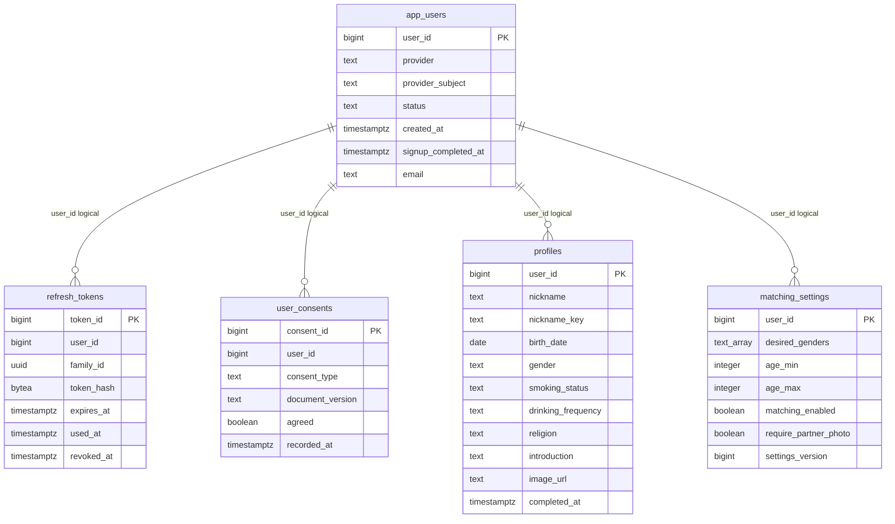
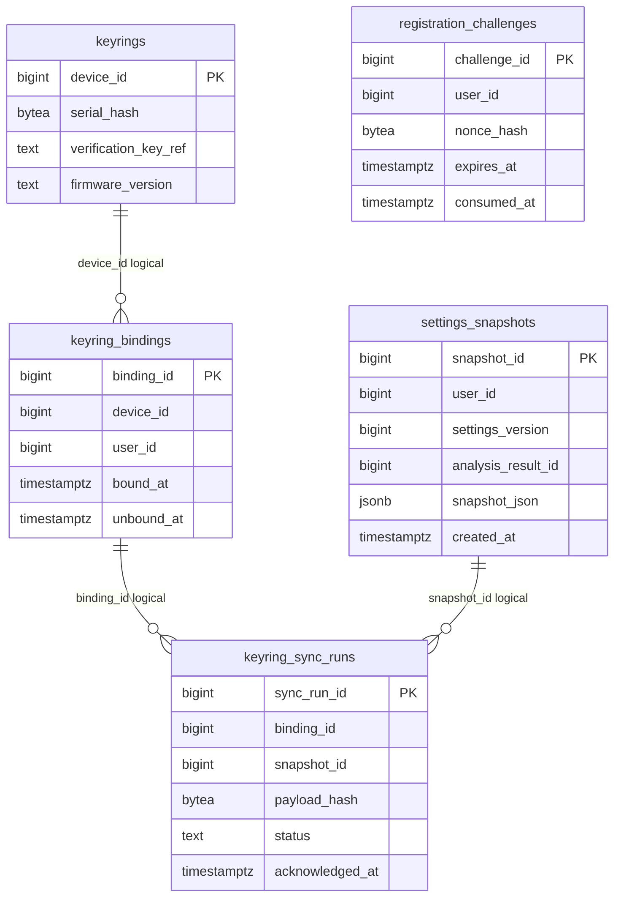
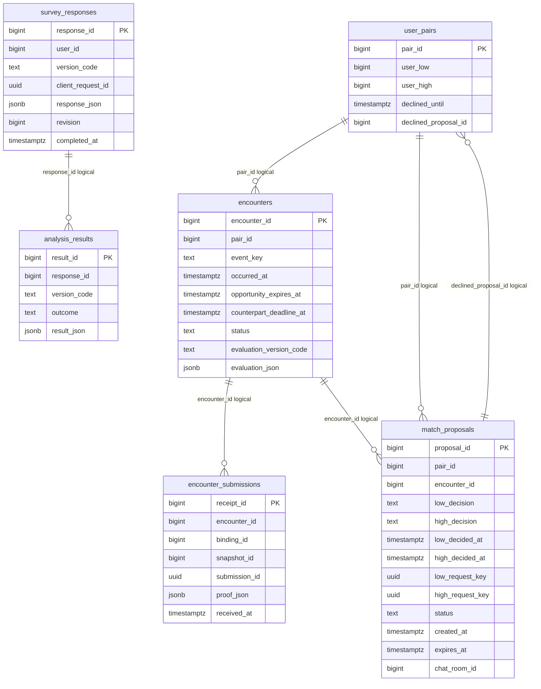
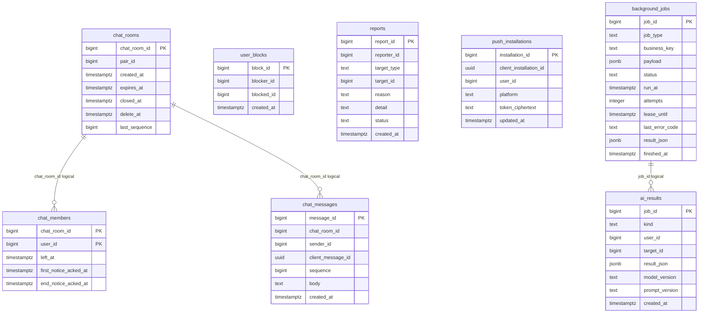

# Tingle(팅글) ERD·테이블 정의

1.1.0-review / 수정 2026-10-21 11:47 KST. **24개 테이블·166개 컬럼**, PostgreSQL·JPA 기준. 물리 외래 키는 없으며 아래 관계는 서비스가 검사하는 논리 참조다. 검토 SQL을 실제 DB에 실행하지 않았다.

[API](../contracts/api/README.md) / [SQL](schema.sql) / [ERDCloud 가져오기 SQL](erdcloud-import.sql) / [기계판독 정의](tables.json) / [기존안·수정안 비교](changes-20261021.md) / [기능 대응표](../specifications/coverage.md)

## 구조 원칙

- 회원당 하나의 소셜 로그인 연결, 현재 프로필 사진 한 장은 URL로 저장한다. 여러 소셜 계정 연결·사진별 처리 이력은 현행 범위에 없다.
- 원응답과 개인 결과, 두 사람의 당시 설정 사본과 실제 매칭 판정을 구분한다. 설문/규칙은 버전별 불변 파일과 과거 파일을 함께 보존한다.
- 키링 증명·토큰 회전·공개 ID/버전 대응은 인증·FE·IoT와 확인할 계약이다. 표의 bigint는 내부 저장 타입이며 공개 UUID를 자동으로 바꾸지 않는다.
- 업무 유일 제약·조건부 갱신·잠금·시간 검사는 유지한다. 물리 FK가 없으므로 존재/소유권과 탈퇴·삭제 정리는 서비스 책임이다.
- 예약·재시도는 background_jobs 한 곳, 메시지의 세 번호는 서로 다른 역할이 있어 모두 유지한다. 실제 구현 증거 없이 원자성·삭제·재시도 보장이 완료됐다고 표시하지 않는다.

## 테이블 목록

| 테이블 | 쓰는 곳 | 컬럼 수 |
| --- | --- | ---: |
| `app_users` | 회원·단일 소셜 로그인 계정 | 7 |
| `refresh_tokens` | 리프레시 토큰·회전 계열; 인증 담당과 조정할 초안 | 7 |
| `user_consents` | 약관·선택적 AI 분석 동의 이벤트 | 6 |
| `profiles` | 회원 프로필과 사진 한 장 | 11 |
| `matching_settings` | 회원별 희망 조건·매칭 설정·키링 반영 버전 | 7 |
| `keyrings` | 실물 키링 식별·검증 정보; 37번 계약 확인 | 4 |
| `keyring_bindings` | 기기 소유 연결 이력 | 5 |
| `registration_challenges` | 일회성 키링 등록 검증; 37번 계약 확인 | 5 |
| `keyring_sync_runs` | 설정 동기화 요청과 기기 저장 확인 | 6 |
| `survey_responses` | 설문 회차·문항별 응답·재개 상태 | 7 |
| `analysis_results` | 개인 성향 계산 결과·재계산 이력 | 5 |
| `settings_snapshots` | 키링·오프라인 만남 당시의 설정 보존 | 6 |
| `user_pairs` | 동일 회원 쌍·동시 처리 잠금·거절 제한 | 5 |
| `encounters` | 양쪽 제출을 묶는 만남·최종 판정 | 9 |
| `encounter_submissions` | 각 기기의 제출·재전송·증명 | 7 |
| `match_proposals` | 제안·고정 두 사람의 선택·방 연결 | 13 |
| `chat_rooms` | 7일 대화와 종료 후 30일 보관 | 7 |
| `chat_members` | 참여자별 입장·두 안내의 표시 확인 | 5 |
| `chat_messages` | 메시지와 순서·재전송 키 | 7 |
| `user_blocks` | 방향성 차단과 해제 | 4 |
| `reports` | 신고 접수와 처리 상태 | 8 |
| `ai_results` | AI 생성 결과와 위험 분석 결과 한 곳 | 8 |
| `push_installations` | 앱 설치별 푸시 전달 주소 | 6 |
| `background_jobs` | 안내·AI·삭제의 실제 예약·실패 재시도 | 11 |

## 논리 관계도

다이어그램의 선은 DB 외래 키 제약이 아니다. 도메인 간 연결 대상은 아래 컬럼 설명에 기재한다.

### 회원·프로필·설정

### 키링·설정 사본

### 설문·분석·만남·제안

### 채팅·안전·AI·후속 처리

## 컬럼 설명과 제약

## 회원·단일 소셜 로그인 계정 (`app_users`)

| 저장 항목 | 의미 | 비워 둘 수 있나 |
| --- | --- | --- |
| `user_id` | 내부 식별자; 서버/DB 생성 | 불가 |
| `provider` | 소셜 제공자 코드; 로그인 계약 기준 | 불가 |
| `provider_subject` | 서버가 검증한 공급자 사용자 식별값 | 불가 |
| `status` | ACTIVE / SUSPENDED / WITHDRAWN | 불가 |
| `created_at` | 최초 계정 생성 | 불가 |
| `signup_completed_at` | 최초 전체 가입 완료; 완료 전 NULL | 가능 |
| `email` | 소셜 이메일, 연락용. 식별에 쓰지 않고 응답에 넣지 않음. 개인정보 수집(PRIVACY) 동의 회원만 저장 | 가능 |

중복 금지 조합: provider + provider_subject.

## 리프레시 토큰·회전 계열; 인증 담당과 조정할 초안 (`refresh_tokens`)

| 저장 항목 | 의미 | 비워 둘 수 있나 |
| --- | --- | --- |
| `token_id` | 내부 식별자; 서버/DB 생성 | 불가 |
| `user_id` | 회원 연결 대상: `app_users.user_id`. | 불가 |
| `family_id` | 같은 로그인에서 회전된 토큰 계열; sid 로그인 세션 테이블과 별개 | 불가 |
| `token_hash` | 고엔트로피 난수 토큰의 SHA-256; 원문 미저장 | 불가 |
| `expires_at` | 이 토큰의 만료 | 불가 |
| `used_at` | 정상 회전에서 소비된 시각 | 가능 |
| `revoked_at` | 서버가 폐기한 시각 | 가능 |

중복 금지 조합: token_hash.

## 약관·선택적 AI 분석 동의 이벤트 (`user_consents`)

| 저장 항목 | 의미 | 비워 둘 수 있나 |
| --- | --- | --- |
| `consent_id` | 내부 식별자; 서버/DB 생성 | 불가 |
| `user_id` | 동의 주체 연결 대상: `app_users.user_id`. | 불가 |
| `consent_type` | 동의 종류; 필수 약관과 선택적 분석 동의 구분 | 불가 |
| `document_version` | 사용자가 확인한 정확한 문서 버전 | 불가 |
| `agreed` | 동의 true, 거절/철회 false | 불가 |
| `recorded_at` | 서버 기록 시각 | 불가 |

## 회원 프로필과 사진 한 장 (`profiles`)

| 저장 항목 | 의미 | 비워 둘 수 있나 |
| --- | --- | --- |
| `user_id` | 회원; 공유 PK 연결 대상: `app_users.user_id`. | 불가 |
| `nickname` | 표시 닉네임 | 가능 |
| `nickname_key` | 정규화한 중복 검사 키 | 가능 |
| `birth_date` | 실제 생년월일; 상대 응답 미공개 | 가능 |
| `gender` | 성별 코드 | 가능 |
| `smoking_status` | 흡연 코드 | 가능 |
| `drinking_frequency` | 음주 코드 | 가능 |
| `religion` | 종교 코드; 선택 | 가능 |
| `introduction` | 자기소개; 선택 | 가능 |
| `image_url` | 현재 사진의 저장소 참조 URL; 선택 | 가능 |
| `completed_at` | "프로필 등록 완료" 시각. 이후 생년월일·성별 고정, 완료 전(임시 저장 중) NULL | 가능 |

중복 금지 조합: nickname_key.

## 회원별 희망 조건·매칭 설정·키링 반영 버전 (`matching_settings`)

| 저장 항목 | 의미 | 비워 둘 수 있나 |
| --- | --- | --- |
| `user_id` | 회원; 공유 PK 연결 대상: `app_users.user_id`. | 불가 |
| `desired_genders` | 희망 상대 성별; 아직 미입력인 초안이면 NULL | 가능 |
| `age_min` | 희망 최소 만 나이; 상관없음이면 age_max와 함께 NULL | 가능 |
| `age_max` | 희망 최대 만 나이; 범위의 상한 없음도 NULL | 가능 |
| `matching_enabled` | 매칭 ON/OFF | 불가 |
| `require_partner_photo` | 상대 사진 필수 | 불가 |
| `settings_version` | 프로필·성향·조건 변경과 키링 반영 비교용 실제 버전 | 불가 |

## 실물 키링 식별·검증 정보; 37번 계약 확인 (`keyrings`)

| 저장 항목 | 의미 | 비워 둘 수 있나 |
| --- | --- | --- |
| `device_id` | 내부 식별자; 서버/DB 생성 | 불가 |
| `serial_hash` | 기기 시리얼의 검증용 해시; 원문 미저장 | 불가 |
| `verification_key_ref` | 검증 키 참조; 비밀 키 원문 아님 | 불가 |
| `firmware_version` | 기기 펌웨어 버전 | 불가 |

중복 금지 조합: serial_hash.

## 기기 소유 연결 이력 (`keyring_bindings`)

| 저장 항목 | 의미 | 비워 둘 수 있나 |
| --- | --- | --- |
| `binding_id` | 내부 식별자; 서버/DB 생성 | 불가 |
| `device_id` | 키링 연결 대상: `keyrings.device_id`. | 불가 |
| `user_id` | 연결 회원 연결 대상: `app_users.user_id`. | 불가 |
| `bound_at` | 소유 연결 시작 | 불가 |
| `unbound_at` | 연결 해제; 활성 상태면 NULL | 가능 |

## 일회성 키링 등록 검증; 37번 계약 확인 (`registration_challenges`)

| 저장 항목 | 의미 | 비워 둘 수 있나 |
| --- | --- | --- |
| `challenge_id` | 내부 식별자; 서버/DB 생성 | 불가 |
| `user_id` | 등록을 요청한 회원 연결 대상: `app_users.user_id`. | 불가 |
| `nonce_hash` | 검증용 일회성 값의 해시 | 불가 |
| `expires_at` | 검증 만료 | 불가 |
| `consumed_at` | 소비 완료 | 가능 |

중복 금지 조합: nonce_hash.

## 설정 동기화 요청과 기기 저장 확인 (`keyring_sync_runs`)

| 저장 항목 | 의미 | 비워 둘 수 있나 |
| --- | --- | --- |
| `sync_run_id` | 내부 식별자; 서버/DB 생성 | 불가 |
| `binding_id` | 현재 소유 연결 연결 대상: `keyring_bindings.binding_id`. | 불가 |
| `snapshot_id` | 반영할 불변 설정 연결 대상: `settings_snapshots.snapshot_id`. | 불가 |
| `payload_hash` | 실제 전송할 payload와 ACK 대조용 해시 | 불가 |
| `status` | PENDING / ACKNOWLEDGED / FAILED / SUPERSEDED | 불가 |
| `acknowledged_at` | 기기 저장 완료 확인 | 가능 |

중복 금지 조합: binding_id + snapshot_id.

## 설문 회차·문항별 응답·재개 상태 (`survey_responses`)

| 저장 항목 | 의미 | 비워 둘 수 있나 |
| --- | --- | --- |
| `response_id` | 내부 식별자; 서버/DB 생성 | 불가 |
| `user_id` | 응답 회원 연결 대상: `app_users.user_id`. | 불가 |
| `version_code` | 불변 설문 정의 파일의 버전 코드; 이전 ID가 아니라 코드 문자열로 저장 | 불가 |
| `client_request_id` | 회차 생성 재시도 키 | 불가 |
| `response_json` | answers 객체와 필요한 metadata; 숫자·배열·코드 타입 보존 | 불가 |
| `revision` | 문항별 PATCH 경합·분석 입력 고정을 위한 실제 버전 | 불가 |
| `completed_at` | 완료 | 가능 |

중복 금지 조합: user_id + client_request_id.

## 개인 성향 계산 결과·재계산 이력 (`analysis_results`)

| 저장 항목 | 의미 | 비워 둘 수 있나 |
| --- | --- | --- |
| `result_id` | 내부 식별자; 서버/DB 생성 | 불가 |
| `response_id` | 불변 완료 응답 연결 대상: `survey_responses.response_id`. | 불가 |
| `version_code` | 불변 설문 정의 파일의 버전 코드; 이전 ID가 아니라 코드 문자열로 저장 | 불가 |
| `outcome` | SUCCEEDED / INSUFFICIENT | 불가 |
| `result_json` | 점수·유형·문구·참고 유형 결과 | 불가 |

중복 금지 조합: response_id + version_code.

## 키링·오프라인 만남 당시의 설정 보존 (`settings_snapshots`)

| 저장 항목 | 의미 | 비워 둘 수 있나 |
| --- | --- | --- |
| `snapshot_id` | 내부 식별자; 서버/DB 생성 | 불가 |
| `user_id` | 회원 연결 대상: `app_users.user_id`. | 불가 |
| `settings_version` | 당시 서버 설정 버전 | 불가 |
| `analysis_result_id` | 사용한 개인 계산 결과 연결 대상: `analysis_results.result_id`. | 불가 |
| `snapshot_json` | 매칭에 필요한 조건·특징값·규칙 버전·나이 기준일 | 불가 |
| `created_at` | 스냅샷 생성 | 불가 |

중복 금지 조합: user_id + settings_version.

## 동일 회원 쌍·동시 처리 잠금·거절 제한 (`user_pairs`)

| 저장 항목 | 의미 | 비워 둘 수 있나 |
| --- | --- | --- |
| `pair_id` | 내부 식별자; 서버/DB 생성 | 불가 |
| `user_low` | 작은 회원 ID 연결 대상: `app_users.user_id`. | 불가 |
| `user_high` | 큰 회원 ID 연결 대상: `app_users.user_id`. | 불가 |
| `declined_until` | 명시적 거절 재제안 제한 종료 | 가능 |
| `declined_proposal_id` | 현재 거절 제한의 근거 제안 연결 대상: `match_proposals.proposal_id`. | 가능 |

중복 금지 조합: user_low + user_high.

## 양쪽 제출을 묶는 만남·최종 판정 (`encounters`)

| 저장 항목 | 의미 | 비워 둘 수 있나 |
| --- | --- | --- |
| `encounter_id` | 내부 식별자; 서버/DB 생성 | 불가 |
| `pair_id` | 당사자 쌍 연결 대상: `user_pairs.pair_id`. | 불가 |
| `event_key` | 양쪽 증명에서 동일 만남을 연결할 검증된 키; 37번 형식 확인 | 불가 |
| `occurred_at` | 검증된 만남 발생 시각 | 불가 |
| `opportunity_expires_at` | 만남 기회 만료 | 불가 |
| `counterpart_deadline_at` | 상대 제출 대기 기한 | 불가 |
| `status` | WAITING_FOR_COUNTERPART / EVALUATED / PROPOSED / NOT_MATCHED / EXPIRED_UNPAIRED / REJECTED_INVALID | 불가 |
| `evaluation_version_code` | 불변 설문 정의 파일의 버전 코드; 이전 ID가 아니라 코드 문자열로 저장 | 가능 |
| `evaluation_json` | 최종 판정·각 방향 점수/coverage·제외/미해결 사유 | 가능 |

중복 금지 조합: pair_id + event_key.

## 각 기기의 제출·재전송·증명 (`encounter_submissions`)

| 저장 항목 | 의미 | 비워 둘 수 있나 |
| --- | --- | --- |
| `receipt_id` | 내부 식별자; 서버/DB 생성 | 불가 |
| `encounter_id` | 만남 연결 대상: `encounters.encounter_id`. | 불가 |
| `binding_id` | 당시 소유 연결 연결 대상: `keyring_bindings.binding_id`. | 불가 |
| `snapshot_id` | 당시 기기 반영 설정 연결 대상: `settings_snapshots.snapshot_id`. | 불가 |
| `submission_id` | 기기 측 제출 재시도 키 | 불가 |
| `proof_json` | 검증에 필요한 서명·증명 데이터만; 37번 형식 확인 | 불가 |
| `received_at` | 서버 접수 시각 | 불가 |

중복 금지 조합: binding_id + submission_id; encounter_id + binding_id.

## 제안·고정 두 사람의 선택·방 연결 (`match_proposals`)

| 저장 항목 | 의미 | 비워 둘 수 있나 |
| --- | --- | --- |
| `proposal_id` | 내부 식별자; 서버/DB 생성 | 불가 |
| `pair_id` | 당사자 쌍 연결 대상: `user_pairs.pair_id`. | 불가 |
| `encounter_id` | 제안이 생긴 만남 연결 대상: `encounters.encounter_id`. | 불가 |
| `low_decision` | user_low의 ACCEPT / DECLINE; 미선택 NULL | 가능 |
| `high_decision` | user_high의 ACCEPT / DECLINE; 미선택 NULL | 가능 |
| `low_decided_at` | user_low 최초 결정 | 가능 |
| `high_decided_at` | user_high 최초 결정 | 가능 |
| `low_request_key` | user_low 최초 실제 선택의 UUID 멱등 키 | 가능 |
| `high_request_key` | user_high 최초 실제 선택의 UUID 멱등 키 | 가능 |
| `status` | PENDING / WAITING_FOR_OTHER / ACCEPTED / REJECTED / EXPIRED | 불가 |
| `created_at` | 제안 생성 | 불가 |
| `expires_at` | 생성+24시간 | 불가 |
| `chat_room_id` | 실제로 생성된 방; 생성 전 NULL 연결 대상: `chat_rooms.chat_room_id`. | 가능 |

중복 금지 조합: encounter_id.

## 7일 대화와 종료 후 30일 보관 (`chat_rooms`)

| 저장 항목 | 의미 | 비워 둘 수 있나 |
| --- | --- | --- |
| `chat_room_id` | 내부 식별자; 서버/DB 생성 | 불가 |
| `pair_id` | 당사자 쌍 연결 대상: `user_pairs.pair_id`. | 불가 |
| `created_at` | 최초 실제 방 생성 | 불가 |
| `expires_at` | created_at+168시간 | 불가 |
| `closed_at` | 실제 종료 효력; 정상 자동 종료는 expires_at | 가능 |
| `delete_at` | closed_at+720시간 | 가능 |
| `last_sequence` | 방별 메시지 순번 발급 | 불가 |

## 참여자별 입장·두 안내의 표시 확인 (`chat_members`)

| 저장 항목 | 의미 | 비워 둘 수 있나 |
| --- | --- | --- |
| `chat_room_id` | 방; 복합 PK 연결 대상: `chat_rooms.chat_room_id`. | 불가 |
| `user_id` | 참여 회원; 복합 PK 연결 대상: `app_users.user_id`. | 불가 |
| `left_at` | 허용된 퇴장 시각; 정책 미정이면 기록하지 않음 | 가능 |
| `first_notice_acked_at` | 첫 입장 안내 표시 확인 | 가능 |
| `end_notice_acked_at` | 종료 1시간 전 안내 표시 확인 | 가능 |

## 메시지와 순서·재전송 키 (`chat_messages`)

| 저장 항목 | 의미 | 비워 둘 수 있나 |
| --- | --- | --- |
| `message_id` | 서버가 저장한 메시지의 고유 번호 | 불가 |
| `chat_room_id` | 방 연결 대상: `chat_rooms.chat_room_id`. | 불가 |
| `sender_id` | 검증된 보낸 회원 연결 대상: `app_users.user_id`. | 불가 |
| `client_message_id` | 앱이 보내기 전에 만드는 전송 구분 번호; 재전송 중복 저장 방지 | 불가 |
| `sequence` | 해당 채팅방 안에서의 메시지 순서 번호; 정렬·재접속 조회에 사용 | 불가 |
| `body` | 메시지 본문 | 불가 |
| `created_at` | 서버 저장 | 불가 |

중복 금지 조합: chat_room_id + sender_id + client_message_id; chat_room_id + sequence.

## 방향성 차단과 해제 (`user_blocks`)

| 저장 항목 | 의미 | 비워 둘 수 있나 |
| --- | --- | --- |
| `block_id` | 내부 식별자; 서버/DB 생성 | 불가 |
| `blocker_id` | 차단한 회원 연결 대상: `app_users.user_id`. | 불가 |
| `blocked_id` | 차단된 회원 연결 대상: `app_users.user_id`. | 불가 |
| `created_at` | 차단 | 불가 |

중복 금지 조합: blocker_id + blocked_id.

## 신고 접수와 처리 상태 (`reports`)

| 저장 항목 | 의미 | 비워 둘 수 있나 |
| --- | --- | --- |
| `report_id` | 내부 식별자; 서버/DB 생성 | 불가 |
| `reporter_id` | 신고자 연결 대상: `app_users.user_id`. | 불가 |
| `target_type` | PROPOSAL / CHAT_ROOM / MESSAGE | 불가 |
| `target_id` | target_type에 해당하는 내부 ID | 불가 |
| `reason` | 신고 사유 코드 | 불가 |
| `detail` | 추가 설명; 선택 | 가능 |
| `status` | RECEIVED / REVIEWING / RESOLVED | 불가 |
| `created_at` | 접수 | 불가 |

## AI 생성 결과와 위험 분석 결과 한 곳 (`ai_results`)

| 저장 항목 | 의미 | 비워 둘 수 있나 |
| --- | --- | --- |
| `job_id` | 생성 작업 ID이자 결과 PK; 별도 IDENTITY 값을 생성하지 않음 연결 대상: `background_jobs.job_id`. | 불가 |
| `kind` | PERSONAL_ANALYSIS / MATCH_EXPLANATION / ICEBREAKERS / RISK_DETECTION | 불가 |
| `user_id` | 요청 또는 분석 적용 회원 연결 대상: `app_users.user_id`. | 불가 |
| `target_id` | kind별 분석 결과/제안/방/메시지 ID; 다형 참조 | 불가 |
| `result_json` | 생성 문구 또는 위험 분류·신뢰도 | 불가 |
| `model_version` | 실제 사용 모델 식별/버전 | 불가 |
| `prompt_version` | 실제 프롬프트 버전 | 불가 |
| `created_at` | 결과 생성 | 불가 |

## 앱 설치별 푸시 전달 주소 (`push_installations`)

| 저장 항목 | 의미 | 비워 둘 수 있나 |
| --- | --- | --- |
| `installation_id` | 내부 식별자; 서버/DB 생성 | 불가 |
| `client_installation_id` | 앱 설치 식별자; 인증 자격 아님 | 불가 |
| `user_id` | 현재 연결 회원 연결 대상: `app_users.user_id`. | 불가 |
| `platform` | ANDROID / IOS | 불가 |
| `token_ciphertext` | 복호화해 전송에 사용하는 암호화 푸시 토큰 | 불가 |
| `updated_at` | 토큰/계정 연결 갱신 | 불가 |

중복 금지 조합: client_installation_id.

## 안내·AI·삭제의 실제 예약·실패 재시도 (`background_jobs`)

| 저장 항목 | 의미 | 비워 둘 수 있나 |
| --- | --- | --- |
| `job_id` | 내부 식별자; 서버/DB 생성 | 불가 |
| `job_type` | 현재 사용하는 CHAT_CREATE / FIRST_ENTRY / END_NOTICE / AI / CHAT_DELETE 등 허용 목록 | 불가 |
| `business_key` | 같은 업무 재생성 방지 키 | 불가 |
| `payload` | 자원 ID·요청 키·필요 버전만; 메시지/토큰 원문 금지 | 불가 |
| `status` | PENDING / RUNNING / SUCCEEDED / FAILED / CANCELLED | 불가 |
| `run_at` | 예약 또는 다음 재시도 가능 시각 | 불가 |
| `attempts` | 작업을 맡아 실행한 누적 횟수; 이전 실행자의 늦은 결과를 구분하며 초기화하지 않음 | 불가 |
| `lease_until` | 현재 실행자가 작업을 맡아 둘 수 있는 마지막 시각 | 가능 |
| `last_error_code` | 최근 비민감 오류 코드; 성공 응답/원문 로그 아님 | 가능 |
| `result_json` | 삭제 저장소 확인 결과 등 꼭 필요한 작업 결과; 일반 전송은 NULL | 가능 |
| `finished_at` | 성공·최종 실패·취소 확정 | 가능 |

중복 금지 조합: business_key.

## 적용할 때 지킬 조건

- survey_versions 제외는 버전별 정의 파일과 과거 버전을 함께 배포하는 전제다. version_code는 파일 저장소에서 존재/호환성을 검사한다. 독립 관리자 게시·롤백 기능이 실제 요구되면 이 테이블은 유지해야 한다.
- keyring_sync_runs는 UNIQUE(binding_id,snapshot_id). 실패 재시도도 같은 run을 재사용한다. 같은 run의 payload는 고정하고 변경이 필요하면 새 snapshot으로 구분한다. 클라이언트가 다른 snapshot으로 재시도한 것을 동일 요청으로 간주하지 않으며 FE·IoT 생성 계약을 맞춘다.
- survey_responses는 completed_at IS NULL 조건으로 같은 사용자·version_code의 진행 중 회차를 하나만 허용한다. 문항 PATCH는 미완료+revision 조건부 갱신. 완료 후 원응답은 불변이며 새 응답은 새 response_id다.
- analysis_results는 UNIQUE(response_id,version_code). 분석은 완료된 불변 응답만 사용한다. 응답 수정을 허용하거나 미완료 분석을 도입한다면 response_revision을 유지해야 한다.
- encounter_submissions는 UNIQUE(binding_id,submission_id)와 UNIQUE(encounter_id,binding_id)를 유지한다. 요청의 수락하는 모든 필드는 기존 행/만남/스냅샷/proof_json에서 정규화 비교 가능해야 한다. 비교하지 못하는 필드가 있다면 request_hash를 유지한다. proof의 서명 검증은 그대로다.
- match_proposals.resolved_at 응답값은 계산 가능하다. REJECTED면 DECLINE인 시각 중 가장 이른 값, ACCEPTED면 양쪽 수락 시각 중 늦은 값, EXPIRED면 expires_at. user_pairs의 거절 제한은 첫 실제 거절+30일로 기록하며 재시도로 갱신하지 않는다.
- chat_rooms의 상태는 closed_at IS NOT NULL 또는 now>=expires_at이면 CLOSED. 활성 방의 UNIQUE(pair_id) 부분 조건은 closed_at IS NULL로 바꾼다. 배치가 늦은 만료 행은 pair 잠금 아래 정확한 expires_at으로 닫은 뒤 후속 작업을 등록한다.
- chat_members는 joined_at=방 생성 시각으로 취급한다. 최초 입장은 FIRST_ENTRY:{room}:{user} 고유 작업 생성으로 기억하고 그 작업은 방의 수명 동안 유지한다. 두 표시 ACK와 푸시 전달 성공을 구분한다. first_entered_at 표시/통계가 요구되면 별도 유지한다.
- user_blocks는 UNIQUE(blocker_id,blocked_id). 해제 시 행을 실제로 지우는 향후 구현안이며 이번 작업에서 데이터를 삭제하지 않았다. 차단/해제 이력이 필요해지면 revoked_at을 유지해야 한다.
- ai_results.job_id는 PK이자 생성 작업의 논리 참조다. AI 결과가 살아 있는 동안 작업 최소 메타데이터도 보존한다. kind→target 매핑: PERSONAL_ANALYSIS=analysis_results.result_id, MATCH_EXPLANATION=match_proposals.proposal_id, ICEBREAKERS=chat_rooms.chat_room_id, RISK_DETECTION=chat_messages.message_id. 존재·종류·소유·현재 공개 권한을 서비스가 검사한다.
- AI 위험 결과의 chat_room_id를 없애도 메시지→방 관계로 종료/삭제 대상을 찾는다. 메시지/방 삭제 전에 관련 AI 결과를 정리한다. target_id만 비교해 다른 kind의 동일 숫자 ID를 삭제하지 않는다.
- background_jobs.attempts는 선점마다 원자 증가하며 운영 재시도에서도 초기화하지 않는다. 워커는 완료/실패 갱신에 job_id·RUNNING·자신의 attempt 값·유효 lease_until을 모두 비교한다. 오래된 워커 결과가 최신 상태를 덮어쓰지 못하게 한다. 재시도 예산을 별도로 초기화해야 한다면 lease_version을 유지한다.

## 적용 상태

SQL 문법·컬럼 수·논리 참조·문서 연결을 정적으로 확인한다. JPA 엔티티·서버·실제 PostgreSQL·ERDCloud 웹·인프라에는 미적용이다. 기존 DB 데이터 변환이나 운영 DDL 절차는 별도 검토한다. Flyway/H2를 추가하지 않는다.
