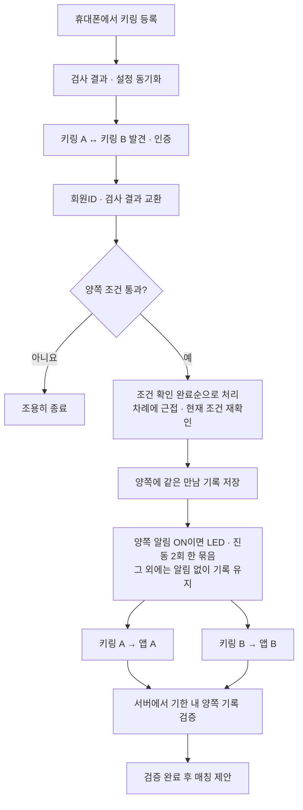

# 키링 통신·데이터·화면 설계 통합 문서

통합일: 2026-10-28 · 김종무(IOT) · 관련 작업: S15P31E106-149

`docs/contracts/iot/`의 통신 명세, 데이터 구조, 화면 설계 MD 3개를 이 문서로 통합했다.
원문의 작성일·버전·검토 상태·미정 항목과 과거 피드백을 보존하고, 제목 계층과 상대 링크를 정리했다.
이번 통합은 문서 위치·구성 정리이며 프로토콜 변경이나 새 합의·실기기 검증 완료를 뜻하지 않는다.
통신 명세의 「이전 메모·피드백」은 당시 참고 기록으로 구분해 읽는다.

현재 제품 기준은 [MVP 명세](../docs/specifications/functional-spec-mvp.md)와 [상세 명세](../docs/specifications/functional-spec-v3.md)다.
Android 가상 키링의 독립 처리 시험 규격은 [LAB-PROTOCOL.md](virtual-keyring/LAB-PROTOCOL.md)에서 확인한다.

## 목차와 원문 출처

| 통합 위치 | 원래 문서 |
| --- | --- |
| [1. 통신 명세](#protocol) | `docs/contracts/iot/protocol-contract-v1.md` |
| [2. 데이터 구조](#data-structures) | `docs/contracts/iot/keyring-data-structures-v1.md` |
| [3. 화면 설계](#screen-design) | `docs/contracts/iot/screen-design-contract-v1.md` |

---

<a id="protocol"></a>

## 1. 통신 명세

### 최종 1차 통신 명세

> 2026-10-27 참조 정리: 아래 v0.1.92/v0.1.81 링크는 작성 당시 기준으로 고정했다. 현재 제품 기준은 [MVP 명세](../docs/specifications/functional-spec-mvp.md)와 [상세 명세](../docs/specifications/functional-spec-v3.md)이며, 본 계약의 후속 합의 반영·실제 기기 검증은 별도다. 이번 변경은 링크 정리이며 통신 계약 구현 완료를 뜻하지 않는다.

작성: 김종무(IOT) / S15P31E106-37 / 2026-10-20

화면 기능·초기화 정책 보완: 2026-10-21 / S15P31E106-90 — 사용자 요청과 Figma 확인 내용 반영, FE·BE 검토 전.

MR 필수 피드백·최신 정책 반영 및 재검토: 2026-10-22. 기준은 [가입·매칭 정책 v0.1.92](https://lab.ssafy.com/s15-final/S15P31E106/-/blob/c4c8131dc4ee09481880a98ee5b0842705e4886b/docs/contracts/matching/profile-policy-v1.md) §4.1·4.2·5와 [기능 명세 v0.1.81](https://lab.ssafy.com/s15-final/S15P31E106/-/blob/c4c8131dc4ee09481880a98ee5b0842705e4886b/docs/specifications/functional-spec-v1.md)의 KEY-01~06·MAT-03·05·PRO-03이다. 기존 활성 키링 한 개안은 최신 정책의 복수 동시 사용으로 대체한다.

2차 피드백과 추가사항을 정리한 1차 초안이다. 세부 필드와 구현 방법은 실제 테스트와 팀 회의를 통해 보완한다. 현재 적용 기준은 이 상단의 「최종 1차 통신 명세」이며, 하단의 이전 메모·피드백은 참고 기록으로 보존한다.

#### 전체 흐름



초기 시간·설정 동기화를 마친 키링은 휴대폰·인터넷 없이 서로 발견·인증·경량 양방향 매칭·기록하고, 알림 설정에 따라 LED·진동을 실행해야 한다. 재연결 후 각자의 기록을 서버로 전달하고 서버 검증을 거쳐 앱의 매칭 제안을 생성한다. 이는 원기획 v1.2와 2026-10-22 사용자가 재확인한 핵심 요구사항이다.

**구현 세부 미정:** 이 IoT 계약에서는 원기획 v1.2와 2026-10-22 사용자 재확인을 기준으로 오프라인 매칭을 확정 기능으로 둔다. 남은 설계는 키링 내 경량 계산 형식, 오프라인 중 변경된 설정·제한의 확인·반영 방법과 단절·재연결 복구다. 서버·앱의 동기화 대기 표시를 미연결 키링의 즉시 중지로 간주하지 않는다. 공통 정책 §4.2·기능 명세 KEY-02·MAT-03에는 오프라인 허용 여부를 합의 대상으로 둔 문구가 남아 있어 문서 간 정합성 확인이 필요하다.

---

#### 휴대폰 ↔ 키링: 등록·동기화

- 휴대폰에 키링 고유 정보를 등록하고, 키링에는 회원ID를 저장한다. MVP는 회원ID를 사용하고 식별용 참조값으로 변경하는 것은 이후 검토한다.
- 한 계정에 여러 키링을 등록·동시 사용할 수 있다. 기기별 최신 설정 반영·준비 상태를 확인하며, 준비된 다른 기기의 참여를 한 기기의 실패 때문에 막지 않는다. 같은 계정의 키링끼리는 자기 매칭하지 않는다.
- JSON 형식으로 검사 결과, 성별·나이·사진 조건, 매칭·알림 설정, 관계 제한, 시간·정책·규칙 버전과 설정 사본 ID를 동기화한다. 상대 성별은 서버가 본인 성별로 자동 확정한 값을 사용한다. 프로필 원문과 사진은 키링에 저장하지 않는다.
- 정보 변경 시 즉시 동기화를 시도하고, 수동·재연결·재시작·자정 자동 시도로 보완한다.
- 전원이 꺼져도 설정과 만남 기록은 유지한다. 키링 재시작 후에는 시간·설정 동기화가 끝난 뒤 새 매칭을 시작한다.

#### 화면 기능에 필요한 휴대폰 ↔ 키링 통신

기존 화면설계의 등록·동기화·내 키링·설정 기능을 지원한다. 아래는 필요한 요청과 응답의 의미이며, 실제 메시지 이름·세부 JSON은 테스트와 팀 협의 후 정한다. 자료형·관리 위치는 [데이터 구조 계약](#data-structures)을 함께 본다.

| 기능 | 휴대폰에서 할 일 | 키링 응답·완료 기준 |
| --- | --- | --- |
| 검색·등록 | 버튼을 길게 눌러 등록 모드에 진입한 키링 검색 → 계정 귀속·양도 전 초기화 안내 → 사용자 동의 | 등록 모드·기기 증명·소유 상태 검증 후 서버 연결 성공 확인. 다른 소유자·영구 사용 불가 기기·동의 취소는 등록하지 않음 |
| 기기 상태 조회 | 연결한 본인 키링의 현재 상태 요청 | 펌웨어·적용 설정 버전·시간·설정 준비 상태·미전송 기록 건수. 적용 정책·알고리즘 버전의 전달 형식과 배터리 측정·지원 방식은 미정 |
| 매칭·알림·사진 조건 변경 | 매칭 참여, 키링 알림, 사진 없는 상대 제외 등을 서버에 저장한 뒤 최소 설정 전송 | 최신 대상 버전을 비휘발성 저장·적용한 응답. 사진은 등록 여부 등 조건만 전달하고 원본은 보내지 않음 |
| LED·진동 테스트 | 선택한 본인 키링에 테스트 실행 요청 | 실행 처리 성공·실패 응답. 실제 부품 동작은 실기기에서 확인. 만남 이벤트·제안 기록을 생성하지 않음 |
| 시간 다시 맞추기 | 앱이 확인한 기준 시각을 전달 | 시간 적용 결과 응답. 시간만 맞췄다고 설정까지 동기화 완료로 표시하지 않음 |
| 만남 기록 확인·전송 | 미전송 건수와 기록을 받고 기록별 서버 저장·삭제 허용 결과를 키링에 전달 | 같은 이벤트 ID를 유지하고 아래 기록별 삭제 허용 조건을 충족한 원본만 정리. 초기화 삭제 동의는 아래 별도 정책 적용 |
| 초기화·등록 해제 | 미전송 기록 처리 선택 후 본인 키링의 서비스 초기화 요청 | 기기 초기화와 서버의 기존 소유 관계 해제가 모두 확인돼야 정상 초기화 완료·양도 가능. 한쪽 실패·미확인은 미완료 |

- 연결 여부·신호 세기는 앱의 BLE 상태로 확인한다. 미연결일 때 마지막 확인 값·시각을 표시하고, 현재 기기 상태로 단정하지 않는다. 신호 세기를 정확한 거리로 표시하지 않는다.
- 미연결 상태에서 테스트를 실행한 것으로 표시하지 않는다. 연결 후 다시 시도하도록 안내한다. 권한 거부·검색 결과 없음·연결 실패도 앱에서 구분한다.
- 키링 재시작을 확인하면 시간·설정 준비 상태를 다시 확인한다. 휴대폰만 재시작한 경우와 구분하며, 단순 24시간 미동기화만으로 전체 매칭을 중단하지 않는다.
- 설정 화면과 알림 화면의 키링 LED·진동 설정은 같은 값을 사용한다. 앱 푸시는 앱·서버 영역의 별도 설정이며 키링 알림 OFF와 혼동하지 않는다.
- 정책 안내의 기간·버전은 서버의 적용 정책 값을 사용한다. 화면에 적힌 7일·24시간·30일 등을 별도 고정값으로 구현하지 않는다.
- 한국어 안내는 화면 문구 예시다. 명령·상태·오류는 언어 독립 코드와 필요한 값으로 전달하고, 앱은 별도 문구 리소스로 표시한다. 세부 코드는 미정이다(I18N03·08).

#### 동기화 결과 표시 기준

| 항목 | 구분할 결과 |
| --- | --- |
| 설정·거절·차단·채팅 관계 반영 | 서버 처리 대기·실패 / 서버 완료·키링 반영 대기 / 키링 저장 완료 |
| 만남 기록 전송 | 휴대폰 수신 / 서버 저장 대기·실패 / 기록별 서버 저장 완료·삭제 허용 여부 |
| 전체 진행 결과 | 진행·응답 대기는 진행 중으로 표시. 실행 결과가 정리된 뒤 모든 대상의 성공 확인 시 완료, 일부 성공이면 부분 완료, 성공 없이 실패가 확인되면 실패 |

서버 대상 버전이 3이고 키링 적용 버전이 2이면 반영 대기다. 늦게 온 버전 2 응답으로 최신 완료를 표시하지 않는다. 설정 반영 성공 시각(`synced_at`)은 저장 완료 응답으로 갱신하고 시도 시각·만남 기록 전송 완료 시각과 구분한다. 현재 대상 기기·실행·내용에 대한 응답인지 확인한다.

최초 사용에 필요한 프로필·검사·희망 조건이 준비된 뒤 초기 동기화를 진행하고, 유효한 시간과 최신 설정의 저장 완료 응답을 확인한 뒤 사용 준비 완료로 표시한다. 기존 회원의 준비된 데이터를 다시 입력하게 하지는 않는다. 자정 자동 동기화는 한국시간 00시에 시도하며 정시 완료를 보장하지 않는다.

설정 저장·재검사 새 결과의 계산 및 저장 성공 후 연결된 모든 등록 기기에 자동 전송하고, 미연결 기기는 재연결 시 최신 버전을 전송한다. 기기별 반영 확인 전에는 해당 기기의 새 매칭을 보류한다. OFF 반영 시 새 매칭과 진행 중·남은 매칭 진동을 중지하며 다른 설정 저장·재로그인만으로 ON으로 되돌리지 않는다. 오프라인 기기의 최신성 확인·즉시 중지 보장 방식은 미정이다.

매칭 OFF가 서버에 저장되면 키링 반영 대기 중에도 서버의 새 제안 생성을 중지한다. 기기에서 실제 중지됐는지는 별도 반영 상태로 표시하며, 기존 유효 제안·채팅과 원래 기한은 유지한다(MAT-05).

최초 매칭 설정은 ON, 사진 없는 상대 제외는 OFF로 시작하되 기존 저장값은 유지한다. 상대 성별은 서버 자동 확정값을 따르고 희망 나이는 사용자가 저장한 조건을 따른다. 편집 중·저장 실패·재검사 계산 실패 값으로 기존 유효 설정을 대체하지 않는다.

로그아웃만으로 저장된 매칭 ON/OFF·유효한 매칭·진동을 중지하지 않는다. 사용자 API의 로그인 권한과 기기 인증·전달 경로는 구분한다. 앱 종료·백그라운드·로그아웃·BLE/인터넷 단절별 보장 범위와 복구는 후속 통신 검증 항목이다. 이미 받은 유효 제안·채팅은 새 설정·재검사 때문에 재심사·취소하거나 기한을 다시 시작하지 않는다.

정상 예시는 「설정 반영 완료 / 기록 전송 완료」다. 일부 성공 시에는 「설정 반영 완료 / 기록 전송 실패 — 다시 시도」처럼 남은 항목을 표시한다. 상대 기록 대기는 매칭 실패가 아니며, 양쪽 기록 검증 전 제안·매칭 푸시를 표시하지 않는다. 검증 탈락이 확정된 경우에는 「이번 만남은 매칭 제안으로 이어지지 않았어요」로 안내하고 상대 정보·구체적인 사유는 숨긴다.

#### 키링 ↔ 키링: 발견·매칭·알림

- 각 키링이 광고와 스캔을 병행하고 서비스ID로 연결 후보를 찾는다. 기기 인증 후 정보를 교환하며, 공개 광고에는 고정 회원ID를 넣지 않는다.
- 바이너리 형식으로 회원ID와 검사 결과를 교환하고, 알고리즘 판정 대기 큐에서 처리한다.
- 양쪽 조건과 매칭 OFF, 성별·나이·사진 조건, 해당 상대와의 채팅·거절·차단 및 종료 후 재매칭 제한을 확인한다. 직접 나가기·AI 동의 철회에 따른 나가기·7일 채팅 종료 상대도 최신 관계 정책대로 제외한다. 관계 목록 전체를 보내지 않고 현재 상대와 매칭 가능한지에 필요한 정보만 교환한다.
- 만남 확정은 조건 확인 완료순으로 처리한다. 차례에 근접·현재 조건을 재확인해 이탈 후보는 건너뛰고, 통과한 경우 양쪽 키링에 같은 event_id, 참여 기기, 만남 시각을 저장한다.
- 이때 적용한 버전·설정 사본 ID·상대 자격 증명·기기별 제출 ID·증빙도 함께 비휘발성 저장한다. 업로드 필수 정보를 확보·저장하지 못한 상태를 만남 저장 완료로 처리하지 않는다. 상세 연결은 아래 업로드 규칙과 데이터 구조 표를 따른다.
- 양쪽 모두 알림 ON일 때만 같은 색 LED와 진동으로 알린다. 한쪽이라도 알림 OFF이면 양쪽 모두 알리지 않고 기록만 저장한다.
- 알림 대상은 실제 상대를 감지하고 조건을 통과한 기기다. 같은 계정의 미감지 기기까지 울리지 않는다. 같은 만남당 해당 기기에서 짧은 진동 2회를 한 묶음으로 한 번만 실행한다.
- 진동 중 해당 기기의 버튼을 누르면 앱·서버 응답 없이 현재 진동과 같은 묶음의 남은 진동을 중지한다. 중지한 안내도 중복 명령으로 다시 시작하지 않는다. 제안 거절·매칭 OFF·등록 모드로 해석하지 않는다.
- 지연 안내는 상대가 아직 근처에 있고 매칭이 유효하며 미안내일 때만 실행한다. 상대가 떠났으면 진동을 생략하되 이미 확정한 기록·유효 제안을 소급 삭제하지 않는다. 진동 길이·간격·버튼 경합·LED 개별 제어와 재시작 복구 방식은 미정이다.

#### 키링 → 앱 → 서버: 만남 기록 전송

- 확정된 만남 기록은 휴대폰 전송 대기 큐에 보관한다. 알고리즘 판정 대기 큐와 구분한다.
- 각 키링의 기록은 각자의 앱이 서버로 전달한다.
- `policyVersion`, `matchingRuleVersion`, `settingsSnapshotId`, `peerCredential`, `evidence`는 만남 당시 값으로 보존한다. 기기별 `submissionId`도 생성 시 고정한다. 설정 변경·재검사·재부팅·재전송 때 현재 값으로 바꾸거나 증빙을 다시 만들지 않는다. 양쪽은 공통 이벤트를 공유하되 각 기기의 설정 사본·상대 증명·제출 증빙은 다를 수 있다.
- 일반 전송에서는 앱이 기록을 읽었다는 이유로 원본을 지우지 않는다. 아래 기록별 삭제 허용 조건을 확인한 뒤 전송용 원본을 정리하고, 같은 상대의 반복 매칭을 막는 상태는 별도로 유지한다. 초기화 시 사용자가 미전송 기록 삭제에 명시적으로 동의한 경우는 아래 정책을 따른다.
- 일반 원본 정리는 대상 기기·이벤트·제출 ID에 대응하는 접수 결과가 `STORED` 또는 `ALREADY_STORED`이고 `canDeleteLocalRecord=true`인 경우에만 한다. `NOT_STORED`·삭제 불허·응답 유실은 원본을 유지하며 배치 HTTP 성공만으로 판단하지 않는다.
- 기한 안에 양쪽의 동일 만남 기록이 서버에서 검증된 뒤 매칭 제안을 생성한다. 같은 두 계정의 동일 만남은 복수 기기가 제출해도 논리적 제안 하나로 처리한다. 만남을 묶는 시간·거리 기준은 미정이다.
- 당시 정보 보존이 제안 생성을 보장하지는 않는다. 서버는 기한·기록 일치·현재 계정 이용 가능 여부·매칭 ON/OFF·최신 관계 제한을 재검증한다. 이용 가능한 유효 제안의 당사자는 수락 전에 최신 공개 프로필을 확인할 수 있으며 채팅은 상호 수락 후 허용한다.

#### 실패·재시도·중복 처리

- 조건 불일치는 조용히 종료한다. 통신 유실·저장 실패는 재시도 대상으로 구분하고, 응답이 없다는 이유만으로 매칭 실패로 확정하지 않는다.
- 기존 기록의 전송 재시도는 허용한다. 같은 이벤트·설정·기록을 다시 받아도 새 이벤트·추가 알림·중복 서버 저장을 만들지 않으며, 세부 처리 방법은 추후 정한다.

#### 초기화·분실 관리

- 사용자가 휴대폰에서 본인 키링의 초기화를 요청할 수 있다. 미전송 만남 기록이 있으면 건수와 삭제 시 복구할 수 없다는 안내를 팝업으로 표시한다. 건수를 확인하지 못하면 먼저 키링에 연결해 확인한다.
- 팝업에서 **기록 삭제 후 초기화 / 기록 동기화 후 초기화 / 취소**를 선택한다. 명시적인 삭제 동의는 해당 초기화 요청에만 적용한다.
- 삭제에 동의하면 미전송 기록을 삭제하고 초기화한다. 이 동의 없이 미전송 기록을 버리지 않는다.
- 기록 동기화 후 초기화를 선택하면 키링의 기록을 휴대폰으로 가져와 서버에 전달한다. 모든 대상 기록에 대해 위의 서버 저장·삭제 허용 조건을 확인한 뒤 초기화·서버 소유 해제를 진행한다. 앱 수신이나 배치 HTTP 성공만으로 동기화 완료로 판단하지 않는다.
- 연결 끊김·휴대폰 수신 실패·서버 저장 실패·삭제 불허·응답 유실 시 기록을 유지하고 초기화를 대기한다. 사용자는 재시도하거나 초기화 실행 전에 취소할 수 있다.
- 삭제 동의는 미전송 기록 처리 방식만 결정한다. 서비스 초기화는 항상 기기 초기화와 서버 소유 관계 해제를 모두 포함한다. 서버 해제 실패·기기 응답 미확인 시 초기화 완료·양도 가능으로 안내하지 않고 실제 상태 확인·재시도를 진행한다. 실행 순서·복구 메시지·나머지 기기 삭제 범위는 미정이다.
- 일반 초기화는 마지막 키링이어도 계정·프로필·설문·기존 유효 제안·채팅과 저장된 ON/OFF를 유지한다. 새 매칭은 등록 기기와 최신 동기화 준비가 있어야 재개한다. 다른 등록 기기의 소유 관계는 해제하지 않는다.
- 연령 미달로 24시간 탈퇴 대기 중이면 초기화·문의만 허용하고 매칭·진동·제안·채팅 이용을 제한한다. 서버의 최초 안내 기한을 유지하며 기한 내 정상 초기화 기기는 재사용 가능, 기한 후 미완료 기기만 영구 사용 불가로 처리한다. 조회 실패만으로 차단을 확정하거나 초기화로 탈퇴 대기를 해제하지 않는다. 중지 전파·제한된 인증·기한 경합은 미정이다(PRO-03·AUTH-03).
- 분실 기기는 서비스팀의 본인·대상 확인 후 영구 사용 불가 처리하며, 계정 삭제·기기 초기화·재등록으로 차단을 해제하지 않는다. 정상 보유 기기와 분실 기기가 섞이면 정상 기기를 먼저 초기화하고 분실 기기만 차단·탈퇴 처리한다. 오프라인 차단 전파·부분 실패 복구는 미정이다.

#### 테스트·팀 회의에서 보완할 내용

| 미정 항목 | 보완할 내용 |
| --- | --- |
| 등록 인증 | 버튼을 누르는 시간·LED 패턴·기기 증명·키 발급 주체. Figma의 3초·앱 발급 문구는 예시 |
| 상세 통신 형식 | 검사 결과·상태 조회·테스트·시간 설정·초기화의 메시지 이름, 필드, 오류 코드, 응답 유실 시 확인·재시도 방식 |
| 복수 기기 | 동시 연결·기기별 상태 전달, 동일 만남을 묶는 시간·거리 기준과 동시 제출 처리 |
| 알림 제어 | 진동 2회 한 묶음은 확정. 길이·간격·버튼 경합·중지 이력 복구, LED 개별 제어, 테스트 패턴·알림 OFF 중 테스트 허용 여부 |
| 상태·시각 확인 | 배터리 측정·잔여 시간 추정, 정책·알고리즘 버전 전달, 재시작·유효 시각 확인 방법 |
| 앱 동작 | Android·iOS 권한·백그라운드·로그아웃·단절별 인증/전달/재시도, 언어 독립 코드. 푸시 동작은 최신 정책 §4.2를 따르고 세부 수신 계약은 FE·BE에서 맞춤 |
| 업로드 증빙 | OpenAPI 필수 필드의 보존은 필수. 상대 자격 증명·기기 증빙의 실제 인증/서명·BLE 형식, 당시 설정 사본의 보관·검증 계약은 BE·AI·IOT 합의 필요 |
| 저장·초기화 | 저장 한도·공간 부족 처리, 미전송 기록 외 초기화 범위, 서버·기기 부분 실패 복구 |

#### 피드백·최신 정책 확인 사례

아래는 후속 구현의 기대 결과이며 실기기 시험 완료 기록이 아니다.

| 확인 사례 | 기대 결과 |
| --- | --- |
| 오프라인 만남 → 설정 변경·재부팅 → 기존 기록 업로드 | 당시 정책·규칙·설정 사본·상대 증명·증빙과 고정 제출 ID 유지. 현재 설정으로 치환하지 않음 |
| 같은 제출 재전송 / 필수 정보 누락 | 동일 내용은 기존 접수 결과로 연결. 누락·다른 내용은 정상 새 제출로 바꾸지 않고 원본 유지·오류 처리 |
| 삭제 미동의 초기화 중 일부 기록이 삭제 불허·응답 유실 | 해당 원본 유지·초기화 대기. 모든 대상의 기록별 저장·삭제 허용 확인 전 소유 해제하지 않음 |
| A 초기화 → 서버 해제 확인 → B 등록 | 기기·서버 두 완료 확인 후 B 등록 가능. 서버 해제 실패 시 완료·양도 가능 표시 금지 |
| 서버 매칭 OFF 저장 / 연령 미달 탈퇴 대기 | 서버는 새 제안 차단. 기기 중지 반영과 미반영을 구분. 탈퇴 대기는 마지막 초기화로 이용 제한·예정 기한 해제 없음 |
| K1 최신 반영 / K2 실패·꺼짐 | K1 참여 유지, K2 대기. 한 기기 초기화로 다른 기기 소유 해제 없음 |
| 동일 만남 재전송·진동 사이 버튼 중지 | 감지 기기만 2회 한 묶음. 중지 후 잔여 취소·중복 재울림 없음. 로그아웃만으로 안내 중지 없음 |

이번 변경은 기존 최소 기록만으로 새 업로드 계약을 충족한다고 보장하지 않는다. 기존 기록에 필수 정보가 없으면 현재 값으로 채워 유효 기록처럼 제출하지 않고 별도 미완료·검증 불가 상태로 처리하며, 이관·정리 방식은 합의한다. 가상·실물은 같은 계약을 따른다. FE·BE·AI·IOT가 당시 정보·증빙 및 초기화 상태를 맞춘 후 서버 수용/재등록 검사와 앱·펌웨어를 합의한 순서로 적용한다. 실제 API 형식은 [API 계약](../docs/contracts/api/README.md)과 [OpenAPI](../docs/contracts/api/openapi.json)를 따르며 API 변경·실기기 검증 완료를 뜻하지 않는다.

---

### 이전 메모·피드백 — 참고용

아래는 작성 과정의 원문 기록이며 현재 적용할 계약이 아니다. 프로필 저장·전원 종료 시 기록 삭제 등 상단 명세와 다른 내용은 상단 기준을 따른다.

### 키링은 스마트폰이든 키링이든 항상 서로 블루투스 통신을 한다.

---

### 키링 / 휴대폰 통신

1. 키링을 서비스에 등록
   - 키링의 고유 정보를 스마트폰에 등록 or 스마트폰의 고유 정보를 키링에 등록한다. (한 가지 방법 선택)
   - 계정 하나에 여러 키링 등록할 수 있다. (사용자가 키링을 잊어버리거나 다양한 스타일의 키링 혹은 키링 버전 업데이트 되는 상황 가정)
2. 사용자 정보 키링 동기화
   - 사용자 검사 결과 키링에 저장한다.
   - 사용자 프로필 키링에 저장한다.
   - 사용자 프로필 or 검사 결과 업데이트 될 때마다 키링에 정보 동기화 한다.

---

### 키링 / 키링 통신

1. 키링 간 통신
   - 서비스 키링(서비스 고유 정보를 송출)만 서로 통신하며 서로의 검사결과? 성향? 공유한다.
2. 알고리즘 매칭
   - 상대방의 키링에 저장된 성향? 검사결과?를 나의 키링으로 받아 나의 키링의 큐 or 스택에 쌓는다.
   - 스택 or 큐에 저장된 상대방의 성향? 검사결과?를 꺼내어 매칭 알고리즘으의 매개변수로 전달.
   - 매칭 알고리즘을 통해 매칭 여부를 판단한다.
      - 매칭 성공 시
        - 키링이 진동하여 사용자에게 물리적으로 알린다.
        - 상대 키링에 저장된 프로필 정보 or 회원ID를 나의 키링의 큐 or 스택에 쌓는다.
        - 내 키링의 큐 or 스택에 저장된 상대 정보를 내 휴대폰으로 송신한다.
      - 매칭 실패 시
        - 뭐 있나?

---

### 피드백 결과

1. 키링 서비스 등록시 키링 고유 정보를 휴대전화에 등록 키링에는 회원ID 등록
2. 한 계정에는 여러 키링 등록 가능
3. 키링 꺼질시(배터리 고갈) 키링 안에 저장된 모든 정보 삭제
4. 키링에 회원정보(회원ID, 검사 결과)를 주기적으로 동기화
5. 키랑 간 통신은 바이너리통신으로 상대 키링과 정보를 주고받는다.
6. 키링 간 통신을 할 때 회원ID와 검자결과 둘 다 받는다.
7. 매칭 알고리즘으로 가기 전 대기하는 큐와 알고리즘 매칭 성공시 휴대전화로 정보 전송 대기하는 큐 이렇게 두 개 사용함.
8. 휴대전화 키링간 통신으로 데이터 주고 받을 때는 JSON형식으로 주고받는다.

---

### 2차 피드백 with AI

1. 휴대폰에 키링 정보, 키링에 회원ID 등록 : 일단은 회원ID를 MVP로 하고 서버가 해석할 수 있는 불투명한 값으로 변경하는 것을 이후로 한다.
2. 계정 하나에 여러 키링 등록 : 여러개 등록 가능 단 활성 키링 한 개로 변경
3. ~~전원이 꺼지면 모든 정보 삭제 : 폐기~~
4. 회원정보 주기적 동기화 : 프로필 정보는 넣지 않는다. 매칭⋅알림 설정, 거절⋅차단⋅채팅 관계 변경도 반영한다. 변경 즉시 시도하고 수동⋅재연결⋅재시작⋅자정 자동 시도로 보완한다.
5. 키링끼리 바이너리 통신 : 이건 어떻게 구현해야 할 지 아직 잘 모르곘음 안해봐서.
6. 회원ID와 검사 결과 교환 : 회원ID와 검사결과(내 성향, 내가 원하는 성향 검사 결과로 구성됨)를 일단 MVP로 구현한다. (이 내용은 후순위 식별용 참조값과 매칭에 필요한 최소 구조화 데이터를 교환하세요. 공개 광고에는 고정 회원ID를 넣지 않고, 필요한 데이터는 인증된 연결에서 교환해야 합니다.)
7. 판정 대기 큐와 후대폰 전송 대기 큐 : 조건 확인 완료순, 반복 매칭 막는 상태는 별도로 유지한다.
8. 휴대폰/키링은 JSON : 나중에 검사결과 필드가 정의되면 진행
9. 양방향 판단 : 매칭 OFF ⋅ 이미 매칭되어 채팅중인 상대인지 ⋅ 거절 ⋅ 차단 정보도 키링에 동기화 하여 저장되고 이 정보도 다른 키링과 통신할 때 보낸다.
10. 양쪽의 동일만남 기록 : event_id, 참여기기, 만남 시각을 기록한다.
11. 알림 조건 확인 : 양쪽 알림 ON일 때만 LED, 진동(LED, 진동은 옵션) 한 쪽이라도 LED, 진동 모두 OFF면 양쪽 모두 OFF
12. 앱을 통한 독립 업로드 : 각 키링의 기록을 각 앱이 서버로 전달한다. 앱이 키링 원본 기록을 읽은 후 지우지 않는다.
13. 서버 검증 후 익명 제안 : 기한 내 양쪽 기록이 검증돼야 제안을 생성
14. 실패 구분 : 조건 불일치는 조용히 종료하되, 통신 유실·저장 실패는 재시도 대상으로 구분한다. 응답이 없다는 사실만으로 ‘매칭 실패’로 확정하지 않습니다.
15. 중복 처리 : 같은 이벤트 · 설정 · 기록을 받아도 새 이벤트 · 추가 진동 · 중복 서버 제출을 만들지 않는 규칙 필요 이건 추후 생각한다.
16. 저장한도: 이것도 실제로 해보면서 고민해봐야 할 듯
17. BLE 연결 역할 : 각 키링이 광고 · 스캔 병행해야 함. 키링 등록시 휴대폰에 동기화된 서비스ID로 각 키링이 해당 서비스 키링인지 판별한다.


#### 추가 사항

- 사용자가 휴대전화로 키링 초기화 요청하면 키링에 들어있는 정보들 초기화.
- 분실시 고객센터 문의 관리자가 가짜 회원 데이터에 키링 연결해서 다른 사람이 등록못하게 한다.
- 진동이나 LED를 수동으로 끌 수 있어야 한다.

---

---

<a id="data-structures"></a>

## 2. 데이터 구조

### 키링 데이터 구조 — 서버 ERD·내부 저장·송수신

> 2026-10-27 참조 정리: 아래 v0.1.92/v0.1.81 링크는 작성 당시 기준으로 고정했다. 현재 제품 기준은 [MVP 명세](../docs/specifications/functional-spec-mvp.md)와 [상세 명세](../docs/specifications/functional-spec-v3.md)이며, 본 계약의 후속 합의 반영·실제 기기 검증은 별도다. 이번 변경은 링크 정리이며 통신 계약 구현 완료를 뜻하지 않는다.

v0.5.1-draft / 2026-10-22 / S15P31E106-90 / 작성: 김종무(IOT)

통신 계약과 화면설계를 기준으로 꼭 필요한 정보를 정리한 전달 초안이다. 컬럼명은 전달용 표기이며, 실제 테이블·API 이름은 BE와 맞춘다. 검사 결과 `{}`의 세부 필드는 추후 협의한다.

영향 파트는 FE·BE·IOT이며 성향 데이터는 AI와도 협의한다. 화면 기능에 필요한 기기 정보와 앱 상태를 보완했으며 FE·BE 검토 전이다. 상세 형식은 [통신 계약](#protocol)과 함께 맞춘다.

최신 기준은 [가입·매칭 정책 v0.1.92](https://lab.ssafy.com/s15-final/S15P31E106/-/blob/c4c8131dc4ee09481880a98ee5b0842705e4886b/docs/contracts/matching/profile-policy-v1.md) §4.1·4.2·5, [기능 명세 v0.1.81](https://lab.ssafy.com/s15-final/S15P31E106/-/blob/c4c8131dc4ee09481880a98ee5b0842705e4886b/docs/specifications/functional-spec-v1.md)의 KEY-01~06·MAT-03·05·PRO-03과 [OpenAPI](../docs/contracts/api/openapi.json)다. 기존 활성 한 개안은 복수 기기 동시 사용으로 대체하고, 서비스 초기화 완료 조건과 만남 당시 업로드 정보 보존을 보완했다.

#### 서버 ERD에 전달할 내용

##### 휴대폰에 키링 등록

- 유저 하나당 여러 키링을 등록할 수 있다. 회원과 키링은 1:N 관계이며, 키링의 현재 소유 회원을 `user_id`로 연결한다.
- 어떤 실물 키링인지 구분할 고유 ID가 필요하다. `keyring_id`
- 서버의 최신 사용자 설정 버전이 필요하다. 기존 회원·설정 테이블의 `setting_version`으로 관리하고, 성향·매칭·알림·관계 정보 변경 시 갱신한다.
- 키링에 실제 저장된 설정 버전이 필요하다. `personal_version` 대신 의미가 명확한 `sync_version`으로 적는다.
- 동기화 대기·완료·실패를 구분한다. `sync_status`
- 키링의 저장 완료 응답으로 동기화 성공을 확인한 시각이 필요하다. `synced_at`
- 키링 테이블에 필요한 정보 : `user_id`, `keyring_id`, `sync_version`, `sync_status`, `synced_at`. 의미가 겹치는 `user` 항목은 제외한다.
- 서버 버전이 3이고 키링 적용 버전이 2이면 동기화가 필요하다. 전송만으로 적용 버전·완료 시각을 갱신하거나, 이전 버전의 늦은 응답으로 최신 완료를 표시하지 않는다.
- 여러 등록 키링이 동시에 참여할 수 있으며 기기마다 버전·준비 상태를 관리한다. 단일 `active_keyring_id`로 참여를 제한하지 않는다. 한 기기의 실패·초기화가 다른 준비된 기기의 참여·소유 관계를 변경하지 않는다.

##### 매칭 완료 후 휴대폰에 정보 전송

- 만남 기본 정보 : `event_id`, `user_a_id`, `user_b_id`, `keyring_a_id`, `keyring_b_id`, `matched_at`. 여기에 아래 「만남 생성 시 보존할 업로드 정보」의 기기별 필수 정보를 함께 연결해야 한다.
- 두 키링이 같은 만남을 기록하고 재전송을 구분할 공통 ID가 필요하다. `event_id`
- 누구와 만났는지 회원 ID 두 개, 어떤 키링으로 만났는지 기기 ID 두 개를 기록한다.
- `matched_at`은 키링에서 만남이 확정된 시각이다. 서버 제안 생성이나 사용자 상호 수락 시각과 구분한다.
- 서버에는 양쪽 기록 접수 여부와 검증 결과가 필요하다. 하나의 테이블에 합친다면 `a_record_received`, `b_record_received`, `records_verified`로 구분할 수 있다. 기존 BE 제출 구조가 있으면 그 구조로 처리한다.
- 만남의 검증 마감도 관리한다. `expires_at` 또는 기존 BE의 기한 정보를 사용하고, 재전송으로 발생 시각·마감을 늘리지 않는다.
- A/B는 회원 ID 순서로 고정하고 기기 정보도 같은 순서로 연결한다. 같은 `event_id`를 다시 받아도 새 만남을 만들지 않는다.
- 양쪽 기록이 기한 내 검증되기 전에는 제안을 만들지 않는다. 상대 기록 대기는 실패와 구분한다.

매칭·알림 설정, 성향 결과, 거절·차단·활성 채팅은 기존 서버 테이블과 연결하고, 키링에 필요한 최소 정보만 동기화한다. 서버에 저장된 매칭 OFF와 계정 이용 제한은 새 제안 검증에도 적용하며 기기 반영 대기와 구분한다. 계정 이용 제한의 기기 전달 필드는 미정이다.

관계 제한에는 직접 나가기·AI 동의 철회에 따른 나가기·7일 채팅 종료 후 재매칭 금지도 반영한다. 탈퇴·재가입 후 제한 유지와 탈퇴 후 1년 만료의 최소 대조·관계 기록은 서버 정책/BE 계약으로 관리하며 기기 초기화로 해제하지 않는다. 키링에 전달할 최소 참조 형식은 미정이다.

#### 아래부터는 키링에 저장 또는 활용될 데이터 구조

##### 키링 안에 저장될 사용자·기기 데이터

- 사용자 ID : `user_id`
- 내 키링 ID : `keyring_id`
- 매칭 사용 여부 : `matching_enabled`
- LED·진동 알림 허용 여부 : `notification_enabled`
- 본인 사진 등록 여부와 사진 없는 상대 제외 조건. 키링에는 판정에 필요한 값만 저장하고 사진 원본은 저장하지 않는다.
- 서비스의 연결 후보를 찾는 고유 ID : `service_id`. 기기 공통 설정이며, 기기 인증을 대신하지 않는다.
- 나의 성향 검사 결과 : `{}`
- 내가 원하는 상대 성향 : `{}`
- 본인 성별·나이와 서버가 자동 확정한 상대 성별·희망 나이 조건의 최소 매칭 값. 정확한 필드는 AI·BE·IOT와 맞추며 키링 간 생년월일 원문은 교환하지 않는다.
- 키링에 적용된 설정 버전 : `sync_version`
- 적용 설정 사본 ID : `settings_snapshot_id`. 서버 동기화 실행의 `settingsSnapshotId`와 연결한다.
- 적용 정책·매칭 규칙 버전 : `policy_version`, `matching_rule_version`. 만남 생성 시 해당 이벤트로 복사해 보존한다.
- 현재 상대와 매칭 가능한지 판단할 거절·차단·활성 채팅 관련 최소 정보.
- 시간·설정 동기화 완료 여부. 키링 재시작 후 다시 확인하기 전에는 새 매칭을 대기한다.
- 설정과 만남 기록은 전원이 꺼져도 유지한다. 프로필 원문과 사진은 저장하지 않는다.

##### 키링 간 통신하며 내가 발신할 데이터

- 서비스 ID : `service_id`
- 내 사용자 ID와 키링 ID : `user_id`, `keyring_id`
- 나의 성향 검사 결과 중 매칭에 필요한 값 : `{}`
- 매칭 사용·알림 허용 여부 : `matching_enabled`, `notification_enabled`
- 본인 사진 등록 여부와 현재 상대에게 적용할 사진 제외 조건 중 양방향 판정에 필요한 최소 값.
- 현재 상대와 매칭 가능한지에 대한 판정 결과. 거절·차단·활성 채팅 목록 전체는 보내지 않는다.
- 사용자 ID·성향 정보는 기기 인증 후 교환한다. 공개 발견 광고에는 고정 사용자 ID를 넣지 않는다.

##### 키링 간 통신하며 내가 수신할 데이터

- 상대 서비스 ID : `service_id`
- 상대가 보낸 사용자 ID와 키링 ID : `user_id`, `keyring_id`. 송신과 같은 필드명을 사용하고 수신 후 상대 정보로 해석한다.
- 상대 성향 검사 결과 중 매칭에 필요한 값 : `{}`
- 상대의 매칭 사용·알림 허용 여부와 현재 나와 매칭 가능한지에 대한 판정 결과.
- 상대의 사진 등록 여부·사진 제외 조건 중 양방향 판정에 필요한 최소 값.
- 양쪽 조건을 통과한 경우에만 만남을 확정한다. 양쪽 모두 알림 ON일 때만 같은 색 LED·진동으로 알리고, 그 외에는 양쪽 모두 조용히 기록만 저장한다.

휴대폰↔키링은 JSON, 키링↔키링은 바이너리 형식으로 주고받는다. 실제 메시지의 세부 필드는 통신 계약에서 맞춘다.

##### 매칭 성공 후 전송 대기할 데이터

- 양쪽 키링이 합의해 저장할 기본 정보 : `event_id`, `user_a_id`, `user_b_id`, `keyring_a_id`, `keyring_b_id`, `matched_at`. 아래 표의 기기별 제출 ID·당시 버전·설정 사본·상대 증명·증빙도 생성 시 함께 저장한다.
- 같은 만남은 양쪽에 같은 이벤트 ID·참여자·기기·시각으로 저장한다.
- 기기별 제출 ID·설정 사본·상대 증명·제출 증빙은 각 기기 기준이다. 양쪽 값을 같게 만들기 위해 복사하거나 현재 설정으로 덮어쓰지 않는다.
- 만남 기록은 전원이 꺼져도 남는 전송 대기 기록이다. 알고리즘 판정 대기 큐와 구분한다.
- 일반 전송에서 각 키링의 기록은 각자의 휴대폰으로 전달한다. 앱이 읽었다는 이유로 삭제하지 않고, 아래 기록별 서버 저장·삭제 허용 조건을 확인한 뒤 전송용 원본을 정리한다. 초기화 시 명시적으로 삭제에 동의한 기록은 아래 초기화 정책을 따른다.
- 전송 대기·서버 저장 확인 상태와 같은 상대의 반복 매칭 억제 상태를 관리한다. 원본을 정리해도 반복 억제 상태는 별도로 유지한다.
- 연결 끊김·저장 실패·응답 유실은 재시도하되, 같은 이벤트의 재전송으로 새 만남이나 추가 알림을 만들지 않는다.

---

#### 최소 수정 반영본 — 표로 보기

바로 위 내용을 표로 정리한 것이다. 예시는 가상 데이터이며 시각은 UTC다. 숫자 ID 예시는 ERD 설명용이며 실제 API 식별자의 형식은 OpenAPI를 따른다. 실제 테이블·필드 이름과 미정 항목은 BE·FE·IOT가 맞춘다.

##### 서버 ERD — 회원 설정·키링 등록

| 저장 위치 | 컬럼 | 설명 | 예시 값 |
| --- | --- | --- | --- |
| 기존 회원·설정 | `matching_enabled` | 매칭 사용 여부 | `true` |
| 기존 회원·설정 | `notification_enabled` | LED·진동 알림 허용 여부 | `true` |
| 기존 회원·설정 | `setting_version` | 서버의 최신 설정 버전. 성향·설정·관계 정보 변경 시 갱신 | `3` |
| 키링 | `user_id` | 현재 소유 회원 참조. 논리적 관계이며 물리 FK 추가를 요구하지 않음 | `10` |
| 키링 | `keyring_id` | 실물 기기를 구분할 키링 ID | `1001` |
| 키링 | `sync_version` | 키링의 저장 완료 응답으로 확인한 적용 버전 | `2` |
| 키링 | `sync_status` | 동기화 대기·완료·실패 | `PENDING` |
| 키링 | `synced_at` | 마지막 기기 저장 성공을 확인한 시각 | `2026-10-21T01:02:00Z` |

- 회원 한 명은 여러 키링을 등록할 수 있고, 한 키링의 현재 소유자는 한 명이다.
- 서버 버전 `3` / 키링 버전 `2`이면 동기화가 필요하다. 최신 버전의 저장 완료 확인 후 적용 버전·상태·시각을 갱신한다.
- `sync_status`는 기기의 설정 반영 상태다. 항목별 진행·전체 부분 완료와 구분하며, 서버 API 상태값과의 매핑은 BE와 맞춘다.
- 성향 결과·희망 조건·관계 제한은 기존 서버 정보를 연결한다. 최신 반영된 기기는 동시에 참여하고, 다른 기기의 동기화 대기로 계정 전체를 중단하지 않는다.

##### 서버 ERD — 만남 기록·양쪽 접수 확인

| 컬럼 | 설명 | 예시 값 |
| --- | --- | --- |
| `event_id` | 두 키링이 공유하는 만남 ID. 재전송도 같은 값 사용 | `E001` |
| `user_a_id` | 참여 회원 A | `10` |
| `user_b_id` | 참여 회원 B | `20` |
| `keyring_a_id` | 만남 당시 A의 키링 | `1001` |
| `keyring_b_id` | 만남 당시 B의 키링 | `2001` |
| `matched_at` | 키링에서 만남이 확정된 시각 | `2026-10-21T01:10:00Z` |
| `expires_at` | 정책에 따른 만남 검증 마감 | `2026-10-28T01:10:00Z` |
| `a_record_received` | A 기록의 서버 저장 여부 | `true` |
| `b_record_received` | B 기록의 서버 저장 여부 | `false` |
| `records_verified` | 양쪽 기록의 검증 완료 여부 | `false` |

위 접수·검증 컬럼은 논리적 확인 항목이다. 현재 BE의 `encounters`, `encounter_submissions`, `settings_snapshots` 구조에서 연결하며 같은 정보를 중복 테이블로 추가하지 않는다. 예시의 7일은 정책을 적용한 값이며 재전송으로 연장하지 않는다. A/B는 회원 ID 순서로 고정한다.

##### 키링 내부 저장 — 사용자·기기·동작 상태

| 항목·필드 | 설명 | 예시 값·상태 |
| --- | --- | --- |
| `user_id` | 이 키링을 사용하는 회원 | `10` |
| `keyring_id` | 본인 키링 ID | `1001` |
| `matching_enabled` | 매칭 사용 여부 | `true` |
| `notification_enabled` | LED·진동 알림 허용 여부 | `true` |
| 사진 등록 여부·사진 없는 상대 제외 | 양쪽 사진 조건 판단에 필요한 값. 실제 기기 필드명은 협의 | 본인 사진 있음 / 사진 없는 상대 제외 OFF |
| `service_id` | 같은 서비스의 연결 후보를 찾는 기기 공통값 | 팀에서 정할 공통 식별값 |
| 나의 성향 검사 결과 | 매칭에 필요한 본인 성향 | `{}` — 상세 필드 협의 |
| 내가 원하는 상대 성향 | 본인의 희망 성향·조건 | `{}` — 상세 필드 협의 |
| `sync_version` | 실제 저장·적용한 설정 버전 | `3` |
| `settings_snapshot_id` | 해당 기기에 적용된 서버 설정 사본 ID. 만남 생성 시 이벤트별 보존 | 서버가 발급한 UUID |
| `policy_version`, `matching_rule_version` | 적용 정책·매칭 규칙 버전. 사용자 설정 버전과 별개 | `policy-demo-1`, `rule-demo-1` |
| 관계 제한 정보 | 거절·차단·활성 채팅을 반영할 최소 정보 | 특정 상대와 새 매칭 제한 |
| 시간·설정 동기화 상태 | 재시작 후 새 매칭 준비 여부 확인 | 재시작 직후 동기화 대기 |

설정과 만남 기록은 전원이 꺼져도 유지한다. 프로필 원문·사진은 저장하지 않는다. `service_id` 확인과 기기 인증은 별개다.

##### 키링 간 송수신 — A 키링 관점

| 정보·필드 | 내가 발신할 값: A→B | 내가 수신할 값: B→A |
| --- | --- | --- |
| `service_id` | 공통 서비스 식별값 | 상대가 사용하는 서비스 식별값 |
| `user_id` | 내 회원 ID `10` | 상대 회원 ID `20` |
| `keyring_id` | 내 키링 ID `1001` | 상대 키링 ID `2001` |
| 성향 검사 결과 | 내 성향 중 매칭에 필요한 값 `{}` | 상대 성향 중 매칭에 필요한 값 `{}` |
| `matching_enabled` | 나의 매칭 사용 여부 | 상대의 매칭 사용 여부 |
| `notification_enabled` | 나의 알림 허용 여부 | 상대의 알림 허용 여부 |
| 사진 조건 | 내 사진 등록 여부·현재 상대에 대한 사진 제외 조건의 최소 값 | 상대 사진 등록 여부·나에게 적용할 사진 제외 조건의 최소 값 |
| 현재 상대와의 매칭 가능 판정 | 내가 관계 제한 등을 확인한 결과 | 상대가 관계 제한 등을 확인한 결과 |

송신·수신의 필드명은 같으며, 받은 값을 상대 정보로 해석한다. 사용자 ID·성향은 인증 후 교환하고 공개 광고에는 고정 사용자 ID를 넣지 않는다. 관계 목록 전체는 보내지 않는다. 양쪽 모두 알림 ON일 때만 LED·진동을 실행한다.

##### 키링 내부 저장 — 만남 기록·전송 대기

| 저장할 정보 | 설명 | 예시 값·상태 |
| --- | --- | --- |
| `event_id` | 양쪽이 합의한 공통 만남 ID | `E001` |
| `user_a_id`, `user_b_id` | 만남에 참여한 회원 | `10`, `20` |
| `keyring_a_id`, `keyring_b_id` | 만남에 참여한 키링 | `1001`, `2001` |
| `matched_at` | 양쪽이 합의한 만남 시각 | `2026-10-21T01:10:00Z` |
| 기기별 필수 업로드 정보 | 아래 표의 제출 ID·당시 버전·설정 사본·상대 증명·증빙을 함께 비휘발성 저장 | 만남 당시 값 고정 |
| 전송·서버 저장 확인 상태 | 서버에 기록이 저장됐는지 확인하기 위한 상태 | 전송 대기 / 서버 저장 확인 |
| 반복 매칭 억제 상태 | 같은 상대의 새 이벤트·추가 알림을 막는 상태 | 해당 상대와 진행 중인 만남 있음 |
| 기기별 만남 안내 상태 | 실제 감지 기기·이벤트와 안내 시작/완료/수동 중지를 연결. 같은 만남의 재울림 방지 | 수동 중지 → 남은 진동 취소 |

일반 전송에서 각 기록은 각자의 휴대폰을 통해 전송한다. 앱이 읽은 것만으로 지우지 않고 아래 기록별 서버 저장·삭제 허용 조건을 확인한 뒤 전송용 원본을 정리한다. 반복 매칭 억제 상태는 별도로 유지한다. 휴대폰↔키링은 JSON, 키링↔키링은 바이너리 형식이다.

##### 만남 생성 시 보존할 업로드 정보

만남 확정 시 아래 값을 기록과 함께 비휘발성 저장한다. 앱은 현재 프로필·설정으로 복원하지 않고 이 값으로 `POST /api/v1/offline-encounters/sync` 요청을 구성한다. 필수 정보 확보·저장 전에는 만남 기록 저장 완료로 표시하지 않는다.

| 저장·연결할 정보 | API 필드 | 자료형·필수 | 기준 |
| --- | --- | --- | --- |
| 만남 당시 제출 기기의 API 식별자 | 배치의 `deviceId` | UUID 문자열 / 필수 | 등록·동기화 시 확인한 식별자 또는 변하지 않는 매핑을 보존. 현재 다른 기기로 바꾸지 않음 |
| 기기별 고정 제출 ID | `submissionId` | UUID 문자열 / 필수 | 이벤트 생성 시 정하고 재전송·재부팅에도 같은 값 사용 |
| 양쪽 공통 만남 ID | `eventId` | UUID 문자열 / 필수 | 내부 `event_id`와 연결. 재시도로 새 ID 발급하지 않음 |
| 만남 확정 시각 | `occurredAt` | UTC 시각 문자열 / 필수 | `matched_at`과 연결. 업로드 시각으로 변경하지 않음 |
| 당시 정책 버전 | `policyVersion` | 문자열 / 필수 | 해당 만남에 실제 적용한 버전 |
| 당시 매칭 규칙 버전 | `matchingRuleVersion` | 문자열 / 필수 | 해당 만남의 계산·판정 규칙 버전 |
| 해당 제출 기기의 당시 설정 사본 ID | `settingsSnapshotId` | UUID 문자열 / 필수 | 만남에 사용한 `settings_snapshot_id`. 서버의 불변 사본과 연결 |
| 당시 상대 자격 증명 | `peerCredential` | 문자열 / 필수 | 인증된 교환에서 확보한 원래 값. 현재 상대 정보로 새로 만들지 않음 |
| 해당 기기의 만남 증빙 | `evidence` | `DeviceProof` 객체 / 필수 | `protocolVersion`·base64 `payload` 보존. 실제 증명·서명 형식은 BE·IOT 합의 필요 |

공통 이벤트 정보는 양쪽이 일치해야 하지만 설정 사본·상대 자격 증명·증빙·제출 ID는 기기별로 다를 수 있다. 설정 변경·재검사·재부팅 후에도 당시 값을 유지하고, 서버도 참조 중인 당시 설정 사본을 현재 사본으로 덮어쓰지 않는다. 사본 보관·증명 검증의 세부 계약은 BE와 맞춘다. 회원·기기 A/B 정보는 내부 기록에 연결하고 OpenAPI가 허용하지 않는 추가 필드로 그대로 전송하지 않는다.

형식 확인용 가상 업로드 예시다. 아래 증빙은 유효한 서명이 아니며 운영 인증·서버 수용 성공을 의미하지 않는다.

```json
{
  "deviceId": "aaaaaaaa-aaaa-4aaa-8aaa-aaaaaaaaaaaa",
  "submissions": [{
    "submissionId": "11111111-1111-4111-8111-111111111111",
    "eventId": "22222222-2222-4222-8222-222222222222",
    "occurredAt": "2026-10-22T01:10:00Z",
    "policyVersion": "policy-demo-1",
    "matchingRuleVersion": "rule-demo-1",
    "settingsSnapshotId": "33333333-3333-4333-8333-333333333333",
    "peerCredential": "peer-demo-B",
    "evidence": {"protocolVersion": "demo-1", "payload": "AA=="}
  }]
}
```

일반 전송에서는 대상 기기·이벤트·제출 ID에 대응하는 `receiptStatus`가 `STORED`/`ALREADY_STORED`이고 `canDeleteLocalRecord=true`일 때만 원본을 정리한다. `NOT_STORED`·삭제 불허·응답 유실은 원본 유지다. 같은 제출 ID로 다른 내용이 도착하면 정상 새 제출로 바꾸지 않고 충돌로 처리한다. 필수 정보가 없는 과거 기록은 현재 값으로 채우지 않고 검증 불가로 구분하며 이관·정리 방법을 협의한다.

#### 초기화 시 미전송 기록 처리

미전송 기록 선택은 2026-10-21 사용자 합의를 유지한다. 2026-10-22 최신 정책 §4.1·KEY-03에 맞춰 서비스 초기화는 기기 초기화와 서버의 기존 소유 관계 해제를 모두 포함하는 것으로 통일했다. FE·BE 검토 전이다.

| 선택 | 기록·상태 처리 |
| --- | --- |
| 기록 삭제 후 초기화 | 이번 요청의 명시적 삭제 동의 후 미전송 기록 삭제. 기기 초기화와 서버 소유 해제의 두 완료를 확인해야 정상 완료 |
| 기록 동기화 후 초기화 | 키링→휴대폰→서버 전송 후 모든 대상 기록의 저장·삭제 허용 조건 확인. 실패·삭제 불허·응답 유실은 원본 유지·초기화 대기. 확인 후 기기 초기화·서버 소유 해제 진행, 두 완료 전에는 초기화 완료로 표시하지 않음 |
| 취소 | 기록과 기기 등록 상태 유지 |

| 필요한 정보 | 관리 위치·의미 | 예시 |
| --- | --- | --- |
| 미전송 기록 건수 | 키링의 기존 전송 대기 기록에서 확인. 확인하지 못했으면 연결 후 조회 | `2건`, 확인 전에는 `확인 필요` |
| 이번 초기화의 선택 | 앱에서 이번 요청에 대해 관리. 과거의 삭제 동의를 재사용하지 않음 | 삭제 동의 / 동기화 선택 / 취소 |
| 초기화 진행 상태 | 앱에서 기록 동기화·기기 초기화·서버 소유 해제를 각각 확인. 하나라도 실패·미확인이면 정상 완료·양도 가능 표시 금지 | 기록 동기화 대기 / 기기 초기화 대기 / 서버 해제 대기 / 두 완료 확인 |
| 기록별 서버 저장·삭제 허용 여부 | 기존 이벤트·전송 상태와 접수 결과 재사용. 저장 확인과 삭제 허용을 함께 확인 | `STORED`여도 `canDeleteLocalRecord=false`이면 원본 유지 |

서버는 기존 기기 소유 관계와 만남 기록 구조를 사용한다. 기기 초기화로 이미 서버에 저장된 만남·거절·차단 기록을 삭제하지 않는다. 초기화의 나머지 삭제 범위와 앱·서버 필드 매핑은 관련 파트와 맞춘다.

A 초기화 후 두 완료를 확인해야 B의 신규 등록으로 이어진다. 서버 해제 실패는 상태 조회·재시도 대상으로 유지한다. 일반적인 마지막 키링 초기화는 탈퇴가 아니며 기존 유효 제안·채팅·프로필·설문·계정 ON/OFF를 유지하고 다른 등록 기기의 소유를 해제하지 않는다.

연령 미달로 24시간 탈퇴 대기 중인 계정은 초기화·문의만 허용한다. 서버가 최초 안내 기준의 기한과 기기별 완료 상태를 관리하고, 기한 내 정상 초기화한 기기는 보존하며 기한 후 미완료 기기만 영구 사용 불가 처리한다. 조회 실패만으로 차단을 확정하거나 마지막 초기화로 이용 제한·탈퇴 예정 시각을 바꾸지 않는다. 중지 상태 전달·기한 경합의 세부 필드는 BE·FE·IOT 협의 대상이다(PRO-03·AUTH-03).

#### 화면 기능에 필요한 추가 데이터

아래는 내 키링·동기화·설정 화면에서 필요한 정보다. 필드명은 전달용이며 확정된 BLE JSON 스키마가 아니다. **기기에 저장할 정보, 조회 응답, 앱이 관리할 상태**를 구분한다. 서버는 기존 기기·설정·만남 구조를 활용한다.

##### 기기 정보·조회 응답

| 정보·전달용 표기 | 자료형·필요 여부 | 관리 위치·의미 | 예시 |
| --- | --- | --- | --- |
| 기기 고유번호 | 문자열 / 등록 시 필수 | 기기 고정 정보. API의 `deviceSerial`과 연결하고 `keyring_id`와의 대응을 확인 | `SIS-A1F3` |
| `firmware_version` | 문자열 / 필수 | 기기가 제공하는 펌웨어 버전. 서버 API의 `firmwareVersion`과 맞춤 | `v0.3.1` |
| 적용 정책·알고리즘 버전 | 버전값 / 전달 형식 미정 | 실제 적용한 버전. 상세 필드·자료형은 협의 | 정책 `v3`, 알고리즘 `v1` |
| 배터리 잔량 | 숫자 / 측정·지원 방식 미정 | 기기에서 측정 가능한 경우 조회 응답으로 제공. 확인 불가를 0으로 표시하지 않음 | `82%` |
| 미전송 기록 건수 | 정수 / 필수 | 기존 전송 대기 기록에서 계산. 서버 저장 확인 전 기록도 포함 | `2` |
| 시간·설정 준비 상태 | 상태값 / 필수 | 기존 준비 상태를 조회. 연결됨과 새 매칭 준비 완료는 별개 | 시간 동기화 대기 |
| 사진 조건 | boolean / 조건 판단 시 필요 | 본인 사진 등록 여부·사진 없는 상대 제외. 원본 대신 최소 조건만 저장·교환 | `true`, `false` |

등록 증명의 실제 구조와 시간·설정 준비 상태의 전달 방식은 통신 계약에서 보완한다. 키링 간 사진 조건 교환은 양방향 판정에 필요한 최소 값으로 한정한다. 조회·현재 설정과 위의 이벤트별 과거 기록은 구분하며, 새 조회 값으로 과거 기록을 갱신하지 않는다.

##### 앱에서 관리할 상태·요청 결과

| 정보 | 자료형·필요 여부 | 관리 위치·의미 | 예시 |
| --- | --- | --- | --- |
| 연결 상태·신호 세기 | 상태값·수치 / 조회 가능한 경우 | 앱 BLE에서 확인. RSSI는 거리 확정값으로 쓰지 않음 | 연결됨, `-60 dBm` |
| 마지막 상태 확인 시각 | 시각 / 조회 이력이 있으면 필요 | 앱이 기기 값을 확인한 시각. 미연결 때 배터리·버전 등의 과거 값과 함께 표시 | `2026-10-21T01:02:00Z` |
| 항목별 동기화 결과 | 상태값 / 필수 | 설정·관계 반영·기록 전송을 각각 관리. 전체 결과는 이 값에서 판단 | 설정 완료 / 기록 전송 실패 → 부분 완료 |
| 마지막 설정 반영 성공 | 기존 `synced_at` / 성공 이력이 있으면 필요 | 기기 저장 완료를 확인한 시각. 시도 시각·만남 기록 전송 완료 시각과 구분 | `2026-10-21T01:03:00Z` |
| 테스트·시간 맞추기 결과 | 상태값 / 요청한 경우 필요 | 실행 처리·시간 적용의 성공·실패·응답 대기. 만남 기록으로 저장하지 않음 | LED·진동 테스트 처리 완료 / 시간 적용 실패 |

모든 시각 예시는 UTC이며 화면에서 표시 기준에 맞춰 변환한다. 미연결이면 마지막 확인 값임을 표시한다. 배터리 잔여 사용 시간은 측정·추정 방법을 정하기 전에는 확정 값으로 제공하지 않는다.

매칭·키링 알림·사진 필터는 기존 서버 설정과 연결한다. 05 설정·33 알림 화면의 키링 알림은 같은 `notification_enabled`를 사용한다. 앱 푸시는 별도 앱·서버 설정으로 관리한다. 현재 API에 없는 키링 알림 필드 등은 BE와 맞춘다. 서버 JSON은 camelCase이며 `setting_version`은 API `settingsVersion`, 사진 제외 조건은 `requirePartnerPhoto` 등 기존 계약과 연결한다.

정책 안내에 표시할 기간·버전은 서버의 적용 정책에서 가져온다. 기기·화면에 서로 다른 고정값을 두지 않으며, 정책·알고리즘 버전과 사용자 설정 버전은 구분한다.

##### 미정 항목·반영 순서

- 배터리 측정·잔여 시간 추정, 정책·알고리즘 버전의 형식, 실제 BLE 필드명·오류 코드.
- LED·진동 개별 제어·수동 테스트 패턴, 알림 OFF일 때 테스트 허용 여부.
- 등록 인증·복수 기기 동시 연결·동일 만남 식별, OS 권한·백그라운드·로그아웃·단절별 인증/전달/복구. 진동 2회·버튼 중지·복수 동시 참여 자체는 확정 정책이다.
- 초기 동기화 후 휴대폰·인터넷 없이 키링끼리 매칭하는 기능은 원기획 v1.2와 사용자 재확인에 따른 IoT 계약의 확정 요구사항이다. 키링 내 경량 계산 형식·오프라인 중 변경된 설정과 제한의 확인·재연결 반영 방법은 미정이다. 적용 기준과 공통 명세와의 차이는 [통신 계약](#protocol)의 전체 흐름을 따른다.
- 실제 `peerCredential`·`evidence` 인증/서명 형식, 기기별 제출 ID·설정 사본 전달·보관·검증. 필수 필드 보존을 생략한다는 뜻은 아니다.
- 나머지 초기화 범위·부분 실패 복구. 미전송 기록의 삭제 동의 또는 동기화 후 초기화 정책은 위 합의 내용을 유지한다.

이벤트별 필수 정보를 추가했으므로 이전 최소 기록과의 완전한 호환을 보장하지 않는다. 기존 BE 저장 구조와 OpenAPI 필드는 유지하며 FE·BE·AI·IOT가 당시 정보 보존·초기화 상태를 맞춘 뒤 서버 검증/재등록 검사와 앱·펌웨어를 합의한 순서로 적용한다. 가상·실물은 같은 의미를 사용하며 실기기 결과는 후속 검증에서 확인한다. 표시 문구와 언어 독립 상태/오류 코드는 분리한다(I18N03·08).

---

<a id="screen-design"></a>

## 3. 화면 설계

### 키링 화면설계 유지 원칙과 변경 가능 항목

> 2026-10-27 참조 정리: 아래 v0.1.92/v0.1.81 링크는 작성 당시 기준으로 고정했다. 현재 제품 기준은 [MVP 명세](../docs/specifications/functional-spec-mvp.md)와 [상세 명세](../docs/specifications/functional-spec-v3.md)이며, 본 계약의 후속 합의 반영·실제 기기 검증은 별도다. 이번 변경은 링크 정리이며 통신 계약 구현 완료를 뜻하지 않는다.

v0.3.1-draft / 2026-10-22 / S15P31E106-90 / 작성: 김종무(IOT)

**기존 화면설계의 구조를 유지한다. 다만 개발 과정에서 구조 안의 세부 내용은 바뀔 수 있다.**

기준은 [현재 Figma 화면설계](https://www.figma.com/design/6UkrZ5AeVOvj3DTG5pfsAv/Suddenly-I-See-%E2%80%94-E106?node-id=22-2)다. 화면 구성과 기본 흐름을 유지하면서 실기기 테스트와 FE·BE·IOT 협의 결과를 세부 내용에 반영한다.

세부 동작은 최신 [가입·매칭 정책 v0.1.92](https://lab.ssafy.com/s15-final/S15P31E106/-/blob/c4c8131dc4ee09481880a98ee5b0842705e4886b/docs/contracts/matching/profile-policy-v1.md) §4.1·4.2·5와 [기능 명세 v0.1.81](https://lab.ssafy.com/s15-final/S15P31E106/-/blob/c4c8131dc4ee09481880a98ee5b0842705e4886b/docs/specifications/functional-spec-v1.md)의 KEY-01~06·MAT-05·PRO-03을 따른다. 변경 가능하다는 뜻은 확정된 정책·완료 조건을 임의로 바꾼다는 뜻이 아니다.

#### 개발 과정에서 변경될 수 있는 부분

| 기존 화면 | 변경될 수 있는 세부 내용 |
| --- | --- |
| 01 온보딩·03 키링 등록 | 등록 모드·계정 귀속 동의 안내, 미완료 초기 입력의 이동 조건, 오류 안내·버튼 누름 시간. 일반 초기화로 마지막 키링이 없어져도 기존 유효 제안·채팅은 등록 화면으로 막지 않되 계정 이용 제한은 유지 |
| 15 초기 동기화 | 진행 단계의 세부 명칭, 준비 상태·저장 완료 응답을 설명하는 문구와 버튼 활성 조건 |
| 06 동기화·19 결과 | 항목별 진행·대기·실패 표시, 부분 완료 설명, 재시도 버튼의 동작·문구 |
| 20 미연결·32 내 키링 상세 | 복수 등록 기기의 개별 연결·준비·초기화 상태, 제공 가능한 배터리·버전·기록 건수와 확인 시각, 진동·버튼 중지 안내 문구 |
| 05 매칭 설정·33 알림 설정 | 자동 확정 상대 성별·희망 나이·매칭 ON/OFF 및 통합 알림의 표시·반영 상태. LED·진동 개별 제어는 미정이며 앱 푸시는 정책 §4.2에 맞춰 조정 |
| 32 테스트·시간 맞추기 | 테스트 대상·패턴·동작 시간, 요청 결과·연결 필요 안내, 시간 적용 결과 표시 |
| 초기화·등록 해제 팝업 | 미전송 건수·삭제 안내·진행·재시도 문구. 삭제 동의 / 동기화 후 초기화 / 취소 분기는 유지. 동기화 선택 시 기록별 저장·삭제 허용 확인, 정상 초기화는 기기 초기화·서버 소유 해제 두 완료 필수. 탈퇴 대기는 서버의 초기화 기한·이용 제한을 유지 |

위 항목에는 아직 미정인 내용도 포함되어 있다. 화면 추가·삭제나 기본 흐름을 바꾸는 변경이 필요하면 관련 파트와 먼저 협의한다. 이 문서 작성으로 Figma 원본이 변경된 것은 아니다.

통신 동작·완료 조건은 [통신 계약](#protocol), 필요한 정보와 관리 위치는 [데이터 구조 계약](#data-structures)에서 관리한다. 개발 중 세부 내용이 정해지면 두 계약과 화면설계를 함께 맞춘다.
