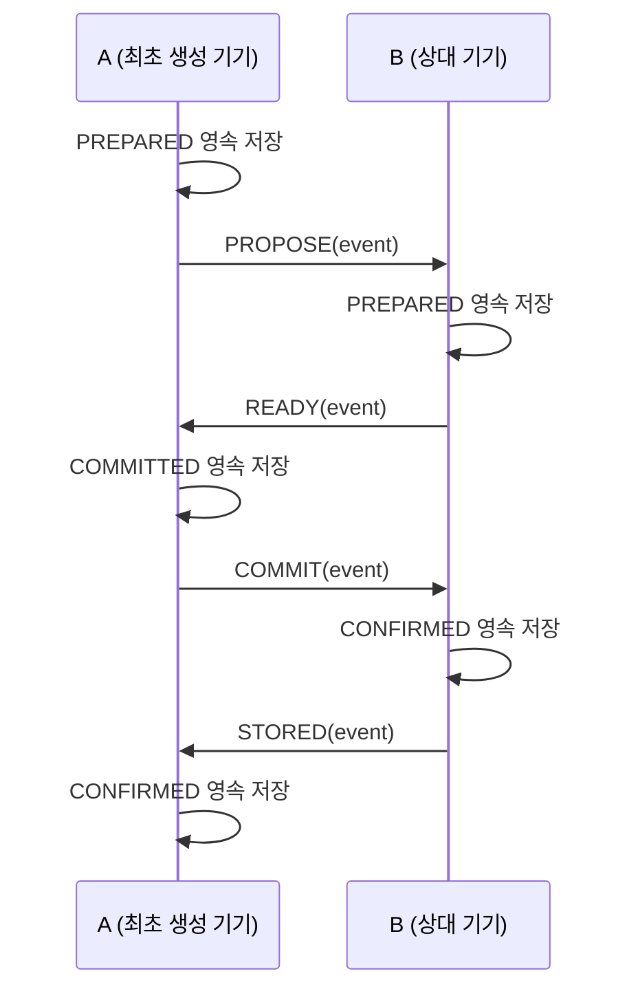

# LAB-1 시험 프로토콜 — 0.1 보존본

버전 1 / 2026-10-22 / S15P31E106-124 / 김종무(IOT). 독립 IoT 시험 앱 0.1.0용이며 FE·BE·실보드의 공식 wire contract가 아니다. 변경 시 양쪽 시험 APK를 함께 업데이트한다. 버전이 다르면 연결 후 메시지를 거부한다. 운영 인증·소유권 확인·증명은 이 형식에 없다.

## BLE 전송

| 항목 | 값 |
| --- | --- |
| 서비스 | `f7e0a100-7d31-4a25-9b2a-4b8c165e0124` |
| RX: A → B | `f7e0a101-7d31-4a25-9b2a-4b8c165e0124`, Write with response |
| TX: B → A | `f7e0a102-7d31-4a25-9b2a-4b8c165e0124`, Indicate |
| TX CCCD | `00002902-0000-1000-8000-00805f9b34fb`, `02 00`으로 구독 |

B는 서비스 UUID만 광고하며 고정 가상 기기 ID·사용자 정보·기기 이름을 광고하지 않는다. A가 검색 결과를 선택하면 연결→서비스 검색→TX indication 구독→양방향 HELLO 순서로 진행한다. 공개 서비스 UUID로 후보를 찾는 것이 인증을 의미하지는 않는다. 발견 목록의 주소 끝부분은 일시적인 구분 표시이며 DB에 MAC 주소를 저장하지 않는다.

각 방향은 GATT 성공 콜백을 받은 뒤 다음 프레임을 보낸다. 한 프레임은 최대 20바이트이므로 기본 ATT MTU 23에서도 동작하고 MTU 협상 성공에 의존하지 않는다. ATT/GATT 전송 성공은 만남 저장 ACK가 아니다.

모든 정수는 big endian이다. 프레임 헤더는 `version:u8=1, transferId:u16, index:u16, count:u16` 7바이트, 본문은 최대 13바이트이다. 마지막 프레임 외에는 20바이트를 사용한다. 수신기는 한 방향에서 순서대로 한 메시지를 조립하며 최대 메시지 512바이트, 최대 40프레임, 조립 15초를 허용한다. 누락·재정렬·잘못된 크기·버전은 연결 오류로 처리한다. 재연결 때 조립 버퍼와 송신 큐를 비운다.

30초 검색, 20초 연결/서비스 확인, 15초 구독/HELLO, 10초 개별 송신·PING 응답은 **시험 앱의 기술 시간 제한**이다. 서비스의 만남 기회·제안·관계 제한 기간을 구현한 값이 아니다. 큐는 최대 160프레임이며 초과 시 연결을 닫고 저장 기록은 유지한다.

## 메시지

공통 헤더는 `protocolVersion:u8=1, messageType:u8`. 아래 필드는 전부 필수이며 추가 바이트를 허용하지 않는다. UUID는 16바이트(상위 64비트, 하위 64비트)다.

| 코드 | 이름 | 본문 |
| --- | --- | --- |
| 1 | HELLO | Peer 41바이트 |
| 2 / 3 | PING / PONG | 같은 correlation UUID 16바이트 |
| 4 / 5 / 6 / 7 | PROPOSE / READY / COMMIT / STORED | 동일 Encounter 106바이트 |
| 8 | ERROR | Java DataOutputStream.writeUTF 형식, 80자 이하 영문 대문자·숫자·밑줄 코드 |

Peer는 `deviceId:UUID, snapshotId:UUID, settingsVersion:i64, ready:u8(0 또는 1)`이다. 기기 ID는 설치 때 로컬 생성한 가상 ID이다. 준비 전 버전은 0, 고정 시험 설정 적용 후 버전은 1이며 같은 설정의 재적용은 사본을 교체하지 않는다. 앱 인스턴스를 다시 만들면 ready=false로 시작한다. 첫 HELLO에는 자신의 HELLO로 한 번 응답해 구독 직후 콜백 순서 차이를 보완한다.

Encounter는 `eventId:UUID, peerA:Peer, peerB:Peer, occurredAt:i64`이다. `occurredAt`은 최초 A 생성 시 기기 시계의 UTC epoch milliseconds이며 양쪽에서 그대로 저장한다. 이벤트 내부 Peer.ready는 생성 당시 true이며, 현재 실행의 준비 상태와 별개다. A/B는 이 시험 이벤트를 최초 생성한 기기/상대 기기 역할이며 운영 계약의 정렬된 회원 쌍이 아니다.

각 DB는 별도 `submissionId:UUID`를 한 번 발급해 영구 보존한다. 재시도에 현재 설정·시각·새 제출 ID를 덮어쓰지 않는다. 운영 정책/매칭 규칙 버전, 실제 상대 credential·서명 proof를 임의로 만들어 넣지 않는다.

## 양쪽 저장 절차

B가 CONFIRMED일 때 A는 COMMIT 전 저장을 마쳤음을 안다. A가 CONFIRMED일 때 B의 저장 ACK를 받았다. 마지막 응답이 유실되면 잠시 한쪽만 CONFIRMED일 수 있으며 완전히 동시인 완료를 보장하지 않는다. 이 상태들은 서버 접수·익명 제안·사용자 동의와 별개다.

| 재시도·오류 | 처리 |
| --- | --- |
| A PREPARED | 같은 PROPOSE 재전송 |
| A COMMITTED/CONFIRMED | 같은 COMMIT 재전송 |
| B PREPARED | 같은 READY 재전송 |
| B CONFIRMED | 같은 STORED 재전송 |
| 같은 PROPOSE 수신 | 동일 내용이면 READY 또는 STORED 재응답, 새 행 생성 없음 |
| 같은 ID·다른 내용 | 충돌 거부, 기존 값 유지 |
| 같은 기기 쌍·다른 이벤트 | 중복 거부, 기존 이벤트 유지 |
| 새로운 PROPOSE의 설정/기기 불일치 | 거부. 기존 기록의 복구는 보존된 당시 사본으로 처리 |
| 저장 트랜잭션 실패 | 해당 단계의 성공 ACK를 보내지 않음 |
| GATT 전송 실패/끊김 | 연결 자원만 정리, DB 유지, 사용자가 재연결·재시도 |
| 오류 메시지 | 성공으로 해석하지 않음. 오류 메시지에 다시 오류를 응답하지 않음 |

기록은 `event_id PRIMARY KEY`, 정렬된 두 가상 기기 ID로 만든 `pair_key UNIQUE`, `submission_id UNIQUE`로 보호한다. SQLite `synchronous=FULL`을 사용하며 커밋이 끝난 뒤 성공을 반환한다. 단계는 후퇴하지 않는다. 시험 앱 저장 한도는 256개 기기 쌍이며, 초과 시 실패로 알리고 기존 기록을 삭제하지 않는다. 실보드의 저장 용량 정책을 확정한 것이 아니다.

정상 예시는 한 이벤트가 양쪽 `CONFIRMED`, 동일 `eventId/occurredAt/설정 사본`, 서로 다른 `submissionId`로 내보내지는 경우다. STORED 유실의 실패/대기 예시는 A=`COMMITTED`, B=`CONFIRMED`이며, 동일 COMMIT 재전송 후 A도 `CONFIRMED`가 된다. 자동 테스트가 이 사례와 저장 단계별 실패를 실행한다.

Android API 근거: [BLE 권한](https://developer.android.com/develop/connectivity/bluetooth/bt-permissions), [GATT 서버](https://developer.android.com/reference/android/bluetooth/BluetoothGattServer), [GATT 콜백](https://developer.android.com/reference/android/bluetooth/BluetoothGattCallback), [광고 API](https://developer.android.com/reference/android/bluetooth/le/BluetoothLeAdvertiser), [백그라운드 제약](https://developer.android.com/develop/connectivity/bluetooth/ble/background).
